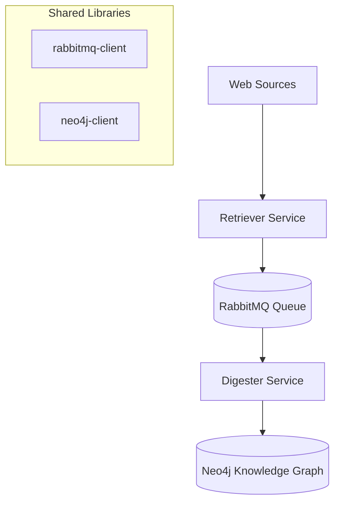

# Aurora: 

Description goes here

## 🏗️ Architecture Overview

Aurora follows a microservices architecture with two main processing services and shared infrastructure libraries:



### 📦 Components

#### Core Services

1. **[Retriever Service](./retriever/)** - Web scraping microservice
   - Scrapes documents from public websites (currently Wi-Fi Alliance)
   - Extracts text content from HTML and PDFs
   - Publishes structured data to RabbitMQ queues

2. **[Digester Service](./digester/)** - Document processing microservice
   - Consumes messages from RabbitMQ
   - Extracts metadata using LLM (OpenAI/Anthropic)
   - Validates and normalizes extracted data
   - Builds knowledge graph in Neo4j

#### Shared Libraries

3. **[rabbitmq-client](./rabbitmq-client/)** - Messaging library
   - Standardized RabbitMQ producer/consumer interface
   - Automatic JSON serialization
   - Used by both services for messaging

4. **[neo4j-client](./neo4j-client/)** - Graph database library
   - Neo4j connection management
   - Graph node models (Resource, Topic, Standard, etc.)
   - Repository patterns for CRUD operations

#### Infrastructure

5. **[common/make-utils.mk](./common/make-utils.mk)** - Shared Docker utilities
   - Common Makefile targets for all services
   - Container and network name generation
   - Dependency management (RabbitMQ, Neo4j)

## 🚀 Quick Start

### Prerequisites

- Docker
- Make
- Environment variables configured (see Environment Setup below)

### Environment Setup

Copy the environment template and configure your settings:

```bash
cp .env.example .env
```

Edit `.env` with your specific configuration values. The template includes all required environment variables with descriptions for:
- Docker network settings
- RabbitMQ connection details
- Neo4j database configuration  
- Azure OpenAI API credentials
- Port mappings and logging levels

See [.env.example](./.env.example) for the complete configuration template.

### Running Services

Each service can be deployed in two modes:

#### 🔒 Isolated Mode (Recommended for Development)
Each service runs with its own isolated infrastructure:

```bash
# Deploy retriever with isolated RabbitMQ
cd retriever
make deploy-isolated

# Deploy digester with isolated RabbitMQ + Neo4j  
cd digester
make deploy-isolated
```

**Benefits:**
- Complete isolation between services
- No dependency conflicts
- Easy to debug individual services
- Each service gets its own ports

#### 🌐 Shared Mode (Production-like)
Services share common infrastructure:

```bash
# Deploy retriever using shared infrastructure
cd retriever  
make deploy-local

# Deploy digester using shared infrastructure
cd digester
make deploy-local
```

**Benefits:**
- Resource efficient
- Services communicate through shared queues
- More production-like setup

## 🛠️ Makefile Commands

Each service provides these common commands:

```bash
# See all available commands
make help

# Deploy service in isolated environment
make deploy-isolated

# Deploy service using shared infrastructure  
make deploy-local

# Clean isolated environments (affects ALL services)
make clean-isolated

# Clean shared infrastructure (use with caution)
make clean-shared

# Nuclear option - remove everything
make nuke
```

## 📚 Service Documentation

- [Retriever Service Details](./retriever/README.md)
- [Digester Service Details](./digester/README.md)  
- [RabbitMQ Client Library](./rabbitmq-client/README.md)
- [Neo4j Client Library](./neo4j-client/README.md)

## 🚦 Current Status

**Implemented:**
- ✅ Wi-Fi Alliance scraper
- ✅ PDF content extraction
- ✅ RabbitMQ messaging
- ✅ Docker containerization
