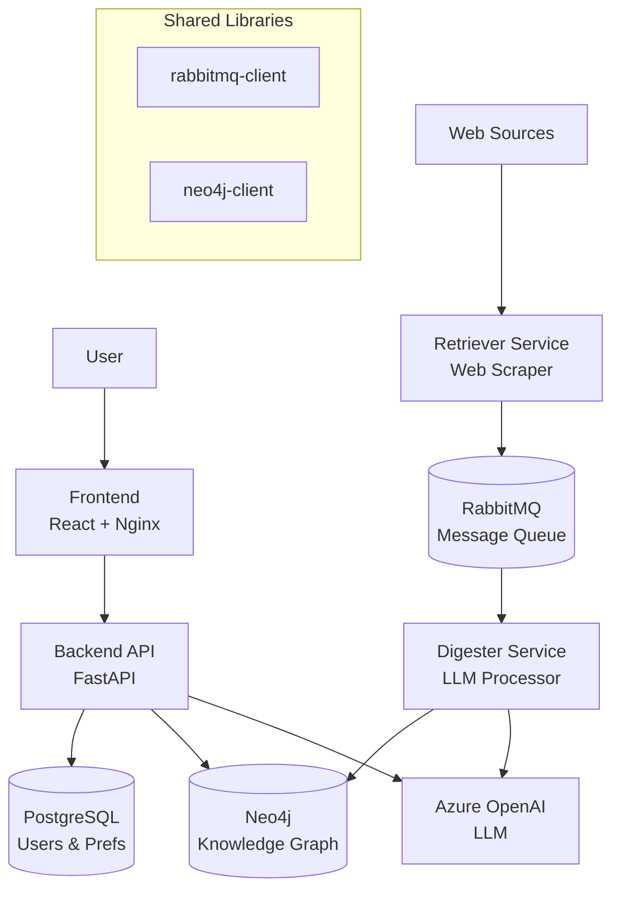

# Aurora: Intelligent Knowledge Management System

Aurora is a comprehensive knowledge management platform that combines web scraping, LLM-powered processing, and graph-based knowledge representation to create an intelligent, queryable knowledge base.

## 🚀 Quick Start with Docker Compose

The easiest way to run the entire Aurora stack:

```bash
# 1. Configure environment
cp .env.docker .env
# Edit .env with your Azure OpenAI credentials and passwords

# 2. Start all services
docker-compose up -d

# 3. Access the application
# Frontend:  http://localhost:3000
# Backend:   http://localhost:8000
# API Docs:  http://localhost:8000/docs
```

📖 **[Full Docker Compose Guide](./DOCKER_COMPOSE.md)**

## 🏗️ Architecture Overview

Aurora follows a microservices architecture with multiple services and shared infrastructure:



### 📦 Components

#### User-Facing Services

1. **[Frontend](./frontend/)** - React web application
   - Professional dark mode interface
   - LLM chat interface with markdown support
   - User management and preferences
   - Knowledge graph browser
   - Real-time backend status monitoring

2. **[Backend API](./backend/)** - FastAPI service
   - User CRUD operations
   - User preferences management
   - Knowledge graph queries
   - LLM-powered document search
   - RESTful API with OpenAPI docs

#### Processing Services

3. **[Retriever Service](./retriever/)** - Web scraping microservice
   - Scrapes documents from public websites (currently Wi-Fi Alliance)
   - Extracts text content from HTML and PDFs
   - Publishes structured data to RabbitMQ queues
   - FastAPI for scraper management

4. **[Digester Service](./digester/)** - Document processing microservice
   - Consumes messages from RabbitMQ
   - Extracts metadata using Azure OpenAI
   - Validates and normalizes extracted data
   - Builds knowledge graph in Neo4j

#### Infrastructure

5. **PostgreSQL** - Relational database
   - User accounts and authentication
   - User preferences storage
   - Event attendance tracking

6. **Neo4j** - Graph database
   - Knowledge graph with Topics, Organizations, People, Resources
   - Relationship mapping
   - Graph queries and traversal

7. **RabbitMQ** - Message queue
   - Asynchronous processing pipeline
   - Decouples scraping from processing

#### Shared Libraries

8. **[rabbitmq-client](./rabbitmq-client/)** - Messaging library
   - Standardized RabbitMQ producer/consumer interface
   - Automatic JSON serialization
   - Used by retriever and digester

9. **[neo4j-client](./neo4j-client/)** - Graph database library
   - Neo4j connection management
   - Graph node models (Resource, Topic, Organization, Person)
   - Repository patterns for CRUD operations

10. **[common/make-utils.mk](./common/make-utils.mk)** - Shared Docker utilities
    - Common Makefile targets for all services
    - Container and network name generation
    - Dependency management

## 🚀 Deployment Options

Aurora supports two deployment methods:

### Option 1: Docker Compose (Recommended)

Run the entire stack with one command:

```bash
# Configure
cp .env.docker .env
# Edit .env with your credentials

# Start
docker-compose up -d

# Access
open http://localhost:3000
```

**Includes:**
- Frontend (port 3000)
- Backend API (port 8000)
- PostgreSQL database
- Neo4j knowledge graph
- RabbitMQ message queue
- Retriever service
- Digester service

📖 **[Complete Docker Compose Guide](./DOCKER_COMPOSE.md)**

### Option 2: Makefile (Development)

Run individual services for development/testing:

#### Prerequisites

- Docker
- Make
- Environment variables configured (see Environment Setup below)

#### Environment Setup

```bash
cp .env.example .env
# Edit .env with your specific configuration
```

The template includes all required variables for:
- Docker network settings
- RabbitMQ connection details
- Neo4j database configuration  
- Azure OpenAI API credentials
- Port mappings and logging levels

#### Running Individual Services

Each service can be deployed in two modes:

#### 🔒 Isolated Mode (Recommended for Development)
Each service runs with its own isolated infrastructure:

```bash
# Deploy retriever with isolated RabbitMQ
cd retriever
make deploy-isolated

# Deploy digester with isolated RabbitMQ + Neo4j  
cd digester
make deploy-isolated
```

**Benefits:**
- Complete isolation between services
- No dependency conflicts
- Easy to debug individual services
- Each service gets its own ports

#### 🌐 Shared Mode (Production-like)
Services share common infrastructure:

```bash
# Deploy retriever using shared infrastructure
cd retriever  
make deploy-local

# Deploy digester using shared infrastructure
cd digester
make deploy-local
```

**Benefits:**
- Resource efficient
- Services communicate through shared queues
- More production-like setup

## 🛠️ Makefile Commands

Each service provides these common commands:

```bash
# See all available commands
make help

# Deploy service in isolated environment
make deploy-isolated

# Deploy service using shared infrastructure  
make deploy-local

# Clean isolated environments (affects ALL services)
make clean-isolated

# Clean shared infrastructure (use with caution)
make clean-shared

# Nuclear option - remove everything
make nuke
```

## 📚 Service Documentation

- [Retriever Service Details](./retriever/README.md)
- [Digester Service Details](./digester/README.md)  
- [RabbitMQ Client Library](./rabbitmq-client/README.md)
- [Neo4j Client Library](./neo4j-client/README.md)

## 🚦 Current Status

**Implemented:**
- ✅ Complete frontend React application with dark mode
- ✅ Backend FastAPI with 14 REST endpoints
- ✅ User management and preferences
- ✅ LLM-powered chat interface
- ✅ Knowledge graph queries
- ✅ Wi-Fi Alliance scraper
- ✅ PDF content extraction
- ✅ RabbitMQ messaging pipeline
- ✅ Docker containerization
- ✅ Docker Compose orchestration
- ✅ Persistent data volumes
- ✅ Health checks and monitoring

## 🌐 Service URLs

Once running with Docker Compose:

- **Frontend**: http://localhost:3000
- **Backend API**: http://localhost:8000
- **API Documentation**: http://localhost:8000/docs
- **RabbitMQ Management**: http://localhost:15672
- **Neo4j Browser**: http://localhost:7474
- **Retriever API**: http://localhost:8001

## 📊 Monitoring

```bash
# View all service logs
docker-compose logs -f

# Check service health
docker-compose ps

# View resource usage
docker-compose stats
```

## 🔧 Development

### Hot Reload Setup

Create `docker-compose.override.yml` for development with hot reload:

```yaml
version: "3.9"
services:
  backend:
    volumes:
      - ./backend:/app/backend
    command: uvicorn api:app --host 0.0.0.0 --port 8000 --reload
```

### Running Tests

```bash
# Backend tests
cd backend
pytest

# Frontend tests
cd frontend
npm test
```

## 🤝 Contributing

1. Fork the repository
2. Create a feature branch
3. Make your changes
4. Test with `docker-compose up`
5. Submit a pull request

## 📝 License

[Add license information]
