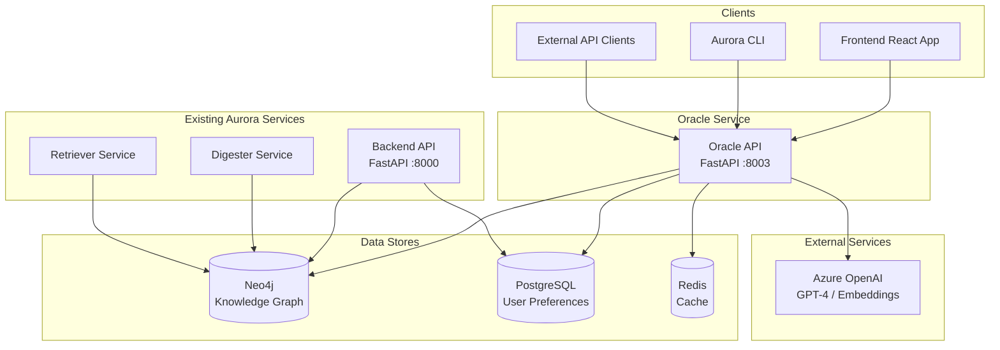
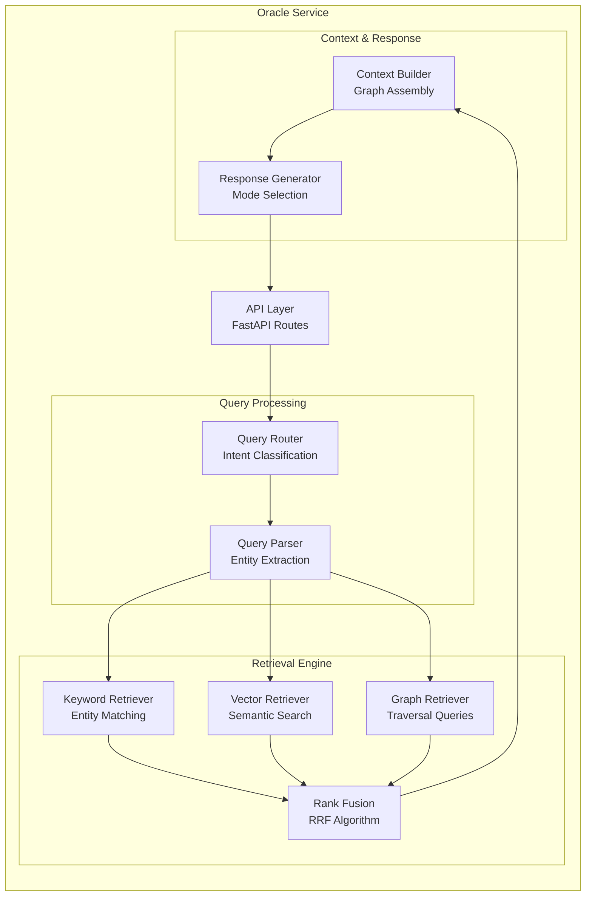

# Oracle Service Implementation Plan

---

## Implementation Status (Updated January 2026)

| Phase | Description | Status |
|-------|-------------|--------|
| **Phase 1** | Core Service Foundation | ✅ **COMPLETE** |
| **Phase 2** | Vector Search Integration | ✅ **COMPLETE** |
| **Phase 3** | Graph-Native Queries | ✅ **COMPLETE** |
| **Phase 4** | Advanced Features & Optimization | ✅ **COMPLETE** |
| **Phase 5** | Enhanced Answers ("Enhance" Button) | ✅ **COMPLETE** |
| **Phase 6** | Analytics & Tracking | ✅ **COMPLETE** |
| **Phase 7** | Backend Migration | ❌ **NOT STARTED** (Low Priority) |

### What's Working Now

- ✅ Full service scaffold with FastAPI, health checks, query endpoint
- ✅ Intent classification (LLM-based with heuristic fallback)
- ✅ Query parsing with entity extraction
- ✅ Keyword retriever with Neo4j
- ✅ Vector retriever with semantic search
- ✅ Hybrid search with Reciprocal Rank Fusion (RRF)
- ✅ Entity resolution (3-tier: exact, alias, vector)
- ✅ Mode selection (retrieval/answer/auto)
- ✅ Response generation with citations
- ✅ Basic graph context (central topics, orgs, related entities)
- ✅ Production data mode via SSH tunnel
- ✅ **GraphRetriever** class with 5 Cypher query patterns
- ✅ Organization hierarchy traversal (parent/child/affiliated orgs)
- ✅ People-topic relationship queries
- ✅ Topic relationship discovery (co-occurrence)
- ✅ Temporal trend analysis (growth rate detection)
- ✅ Cross-org collaboration detection
- ✅ Graph retriever integrated into RRF fusion (3-way: keyword + vector + graph)
- ✅ Organization contribution rankings in graph_data
- ✅ Enhanced context builder with graph_data support
- ✅ **Multi-factor confidence scoring** (document coverage, source quality, recency, consensus, query match)
- ✅ **Query refinement suggestions** (when results are poor, suggests broader/alternative queries)
- ✅ **Ranking explainability** (detailed per-document scoring breakdown with match reasons)
- ✅ **Redis caching** (multi-level: query responses, embeddings, graph context, documents)
- ✅ **Parallel retrieval** (asyncio.gather for concurrent keyword/vector/graph search)
- ✅ **Pre-query analysis** (`/oracle/analyze` endpoint) - analyzes query quality before execution, suggests improvements for vague queries
- ✅ **Enhanced answers** (`/oracle/enhance` endpoint) - full content retrieval, chunking, re-ranking, and detailed answer generation
- ✅ **Retriever content endpoint** (`/retrieve/content`) - fetches full document content with scraper routing
- ✅ **Document chunking** (~500 token chunks with overlap)
- ✅ **Chunk re-ranking** (vector similarity for relevance ordering)
- ✅ **Direct quote extraction** in enhanced answers
- ✅ **Content caching** (Redis, 1hr TTL)
- ✅ **Frontend "Enhance" button** with loading states and enhanced answer display
- ✅ **Custom Prometheus metrics** (query counts, confidence scores, latency, feedback)
- ✅ **Enhanced OTEL spans** (query attributes, intent, mode, cache hit, confidence)
- ✅ **Structured logging for Loki** (query_completed, feedback_submitted events)
- ✅ **User feedback endpoint** (`/oracle/feedback`) with metrics tracking
- ✅ **Grafana dashboard** (Oracle Analytics dashboard with 16 panels)
- ✅ **Frontend feedback UI** (thumbs up/down buttons on query responses)
- ✅ **Query history storage** (PostgreSQL `oracle_query_history` table for raw data)
- ✅ **Query history API** (`/oracle/history`, `/oracle/history/{id}`, `/oracle/history/stats`)
- ✅ **Admin Query Analytics page** (view query history with filters, stats, and detail view)

### Outstanding Work

**Phase 6: Analytics & Tracking:**
- ✅ Enhanced OTEL spans with query attributes
- ✅ Custom Prometheus metrics for Oracle (via OTEL meter)
- ✅ Grafana dashboard for query analytics
- ✅ User feedback endpoint (`/oracle/feedback`)
- ✅ Frontend feedback UI (thumbs up/down buttons)
- ✅ PostgreSQL query history storage (`oracle_query_history` table)
- ✅ Query history API endpoints (`/oracle/history/*`)
- ✅ Admin Query Analytics page (frontend)

**Phase 7: Backend Migration (Low Priority):**
- ❌ Deprecate old `/query` endpoint in backend service
- ❌ Migrate remaining backend query consumers to Oracle
- ❌ Remove legacy query code from backend
- ❌ Remove PostgreSQL query tracking tables (replaced by OTEL/Grafana)

**Production Readiness:**
- ⚠️ Review `use_prod_data` setting before deployment (currently dev-only feature)
- ❌ Production environment configuration
- ❌ Load testing validation

**Explicitly Out of Scope (V1):**
- Multi-turn conversation memory

---

## Executive Summary

The Oracle Service is a new microservice designed to provide enhanced question-answering capabilities over Aurora's knowledge graph. It addresses limitations in the current search/chat functionality by introducing multi-strategy retrieval, graph-aware context assembly, and dual-mode responses (document retrieval vs. LLM-generated answers).

### The Problem

Aurora's current search/chat functionality has several limitations that impact user experience:

| Issue | Impact |
|-------|--------|
| **Keyword-only matching** | Misses conceptually similar content; typos like "wifi hallow" fail to find "Wi-Fi HaLow" |
| **Flat document retrieval** | Ignores rich graph relationships between topics, organizations, and people |
| **Single response mode** | Users must accept LLM summaries even when they just want document links |
| **Limited query understanding** | Struggles with complex questions involving relationships or temporal patterns |
| **No graph context** | Answers don't leverage organizational hierarchies or topic connections |

### The Solution

The Oracle Service introduces a sophisticated retrieval and response pipeline:

1. **Multi-Strategy Retrieval**: Combines keyword search, vector similarity, and graph traversal to find the most relevant content regardless of how users phrase their queries.

2. **Graph-Aware Context**: Assembles not just documents but their relationships—understanding that a question about "IEEE 802.11 task group" should traverse organizational hierarchies and related topics.

3. **Dual-Mode Responses**: Users choose whether they want:
   - **Retrieval Mode**: Ranked document list with relevance scores for self-directed research
   - **Answer Mode**: LLM-generated response with citations grounded in retrieved documents

4. **Intelligent Query Routing**: Classifies query intent (entity lookup, trend analysis, relationship query) and selects optimal retrieval strategies.

### Value Proposition

| Stakeholder | Benefit |
|-------------|---------|
| **End Users** | More accurate answers, choice of response format, handles natural language variations |
| **Analysts** | Quick document discovery OR deep synthesized answers on demand |
| **Platform** | Modular service enables future enhancements without backend changes |

### Key Differentiators from Current Implementation

| Current Backend `/query` | Oracle Service |
|--------------------------|----------------|
| LLM extracts filters → keyword search | Intent classification → multi-strategy retrieval |
| Fixed summarization behavior | User-selectable retrieval vs. answer modes |
| Entity matching only | Vector similarity + graph traversal |
| Flat document list context | Graph-structured context with relationships |
| Single ranking algorithm | Hybrid ranking with reciprocal rank fusion |

This document outlines the phased implementation approach, technical architecture, and key milestones for delivering the Oracle Service.

---

## Table of Contents

1. [Goals & Success Criteria](#1-goals--success-criteria)
2. [Architecture Overview](#2-architecture-overview)
3. [Phase 1: Core Service Foundation](#3-phase-1-core-service-foundation)
4. [Phase 2: Vector Search Integration](#4-phase-2-vector-search-integration)
5. [Phase 3: Graph-Native Queries](#5-phase-3-graph-native-queries)
6. [Phase 4: Advanced Features & Optimization](#6-phase-4-advanced-features--optimization)
7. [Phase 5: Full Content Retrieval (Future Enhancement)](#7-phase-5-full-content-retrieval-future-enhancement)
8. [Phase 6: Analytics & Tracking (Future Enhancement)](#8-phase-6-analytics--tracking-future-enhancement)
9. [Phase 7: Backend Migration (Low Priority)](#9-phase-7-backend-migration-low-priority)
10. [Production Readiness](#10-production-readiness)
11. [API Specification](#11-api-specification)
12. [Data & Embedding Strategy](#12-data--embedding-strategy)
13. [Testing Strategy](#13-testing-strategy)
14. [Deployment & Migration](#14-deployment--migration)
15. [Observability & Monitoring](#15-observability--monitoring)
16. [Risks & Mitigations](#16-risks--mitigations)
17. [Appendix](#17-appendix)

---

## 1. Goals & Success Criteria

### 1.1 Primary Goals

| Goal | Description |
|------|-------------|
| **G1: Improved Retrieval Accuracy** | Users find relevant documents even with imprecise queries (typos, synonyms, conceptual variations) |
| **G2: User Choice in Response Format** | Users can select between document retrieval (for research) or LLM-synthesized answers (for quick insights) |
| **G3: Graph-Aware Intelligence** | Leverage knowledge graph structure for relationship-based queries and richer context |
| **G4: Production Reliability** | Maintain low latency, high availability, and graceful degradation |
| **G5: Extensibility** | Modular architecture that supports future enhancements (new retrievers, ranking algorithms) |

### 1.2 User Needs Matrix

| User Type | Primary Need | Response Mode | Example Query |
|-----------|--------------|---------------|---------------|
| **Analyst** | Deep research, follow citations | Retrieval | "Show me all Wi-Fi Alliance announcements from Q4" |
| **Executive** | Quick synthesized answer | Answer | "What's the status of Wi-Fi 7 certification?" |
| **Engineer** | Specific technical details | Answer + Sources | "What are the MLO requirements in 802.11be?" |
| **New User** | Exploration, discovery | Retrieval | "What topics are trending this month?" |

### 1.3 Success Metrics

#### Retrieval Quality Metrics

| Metric | Target | Measurement Method |
|--------|--------|-------------------|
| **Precision@10** | ≥ 0.80 | % of top-10 results relevant to query |
| **Recall@50** | ≥ 0.90 | % of all relevant docs in top-50 |
| **MRR (Mean Reciprocal Rank)** | ≥ 0.70 | Average 1/rank of first relevant result |
| **Typo Tolerance** | 90% recovery | Queries with 1-2 typos still return correct results |

#### Answer Quality Metrics

| Metric | Target | Measurement Method |
|--------|--------|-------------------|
| **Groundedness** | ≥ 0.95 | % of claims traceable to retrieved documents |
| **Relevance Score** | ≥ 4.0/5.0 | User rating of answer relevance |
| **Citation Accuracy** | ≥ 0.98 | % of citations pointing to correct source |
| **Completeness** | ≥ 3.8/5.0 | User rating of answer thoroughness |

#### Performance Metrics

| Metric | Target | Notes |
|--------|--------|-------|
| **P50 Latency (Retrieval Mode)** | < 500ms | Document list response |
| **P50 Latency (Answer Mode)** | < 3s | Including LLM generation |
| **P95 Latency (Retrieval Mode)** | < 1s | |
| **P95 Latency (Answer Mode)** | < 5s | |
| **Availability** | 99.5% | Monthly uptime |
| **Error Rate** | < 1% | Non-5xx responses |

### 1.4 Non-Goals (Out of Scope)

| Non-Goal | Rationale |
|----------|-----------|
| **Real-time ingestion** | Oracle queries existing graph; ingestion remains in digester pipeline |
| **Multi-turn conversation** | V1 focuses on single-turn Q&A; conversation history is a future enhancement |
| **Document editing/feedback** | Read-only service; content management stays in existing services |
| **Custom model fine-tuning** | Uses Azure OpenAI as-is; prompt engineering only |
| **Cross-tenant queries** | Single-tenant deployment; multi-tenancy not in V1 scope |
| **Backward compatibility with existing `/query`** | Oracle will fully replace the existing query functionality; no legacy format support needed |
| **Full content retrieval (V1)** | V1 uses summaries only; full content retrieval is a Phase 5 enhancement (see below) |

---

## 2. Architecture Overview

### 2.1 System Context Diagram



### 2.2 Oracle Service Internal Architecture



### 2.3 Component Breakdown

| Component | Responsibility | Key Dependencies |
|-----------|---------------|------------------|
| **API Layer** | HTTP endpoints, request validation, authentication | FastAPI, Pydantic, `common/auth_middleware.py` |
| **Query Router** | Classify query intent, select retrieval strategy | Azure OpenAI (GPT-4) |

> **Note**: Authentication is handled by the existing Aurora auth service via `common/auth_middleware.py`. Oracle does not implement its own authentication—it uses the shared middleware that other services use.
| **Query Parser** | Extract entities, dates, filters from query | Azure OpenAI, regex fallback |
| **Keyword Retriever** | Entity-based Neo4j queries (existing logic) | neo4j-client library |
| **Vector Retriever** | Semantic similarity search using embeddings | Neo4j vector index, Azure embeddings |
| **Graph Retriever** | Multi-hop traversals, relationship queries | Neo4j, Cypher templates |
| **Rank Fusion** | Combine results from multiple retrievers | RRF algorithm |
| **Context Builder** | Assemble graph context around retrieved docs | Neo4j |
| **Response Generator** | Format response based on mode (retrieval/answer) | Azure OpenAI for answer mode |

### 2.4 Data Flow

```
┌─────────────────────────────────────────────────────────────────────────────┐
│                              USER QUERY                                      │
│                    POST /oracle/query {question, mode}                       │
└─────────────────────────────────────┬───────────────────────────────────────┘
                                      │
                                      ▼
┌─────────────────────────────────────────────────────────────────────────────┐
│ 1. QUERY ROUTING                                                             │
│    ├─ Classify intent: entity_focused | topic_discovery | relationship |     │
│    │                   trend_analysis | comparative                          │
│    ├─ Select retrieval strategies based on intent                            │
│    └─ Extract entities, dates, and constraints                               │
└─────────────────────────────────────┬───────────────────────────────────────┘
                                      │
                    ┌─────────────────┼─────────────────┐
                    │                 │                 │
                    ▼                 ▼                 ▼
┌───────────────────────┐ ┌─────────────────────┐ ┌─────────────────────────┐
│ 2a. KEYWORD RETRIEVAL │ │ 2b. VECTOR SEARCH   │ │ 2c. GRAPH TRAVERSAL     │
│     Entity matching   │ │     Embed query     │ │     Multi-hop queries   │
│     Filter by dates   │ │     Cosine sim      │ │     Relationship paths  │
│     Neo4j Cypher      │ │     Neo4j vector    │ │     Org hierarchies     │
└───────────┬───────────┘ └──────────┬──────────┘ └────────────┬────────────┘
            │                        │                         │
            └────────────────────────┼─────────────────────────┘
                                     │
                                     ▼
┌─────────────────────────────────────────────────────────────────────────────┐
│ 3. RANK FUSION                                                               │
│    ├─ Reciprocal Rank Fusion (RRF) across retriever results                 │
│    ├─ Deduplicate by resource URL                                           │
│    └─ Apply recency boost                                                   │
└─────────────────────────────────────┬───────────────────────────────────────┘
                                      │
                                      ▼
┌─────────────────────────────────────────────────────────────────────────────┐
│ 4. CONTEXT ASSEMBLY                                                          │
│    ├─ Fetch full document metadata                                          │
│    ├─ Extract related topics, orgs, people                                  │
│    ├─ Build relationship context                                            │
│    └─ Identify temporal patterns                                            │
└─────────────────────────────────────┬───────────────────────────────────────┘
                                      │
                    ┌─────────────────┴─────────────────┐
                    │                                   │
                    ▼                                   ▼
┌─────────────────────────────────┐   ┌─────────────────────────────────────┐
│ 5a. RETRIEVAL MODE              │   │ 5b. ANSWER MODE                     │
│     Return ranked documents     │   │     Send docs + query to LLM        │
│     with relevance scores       │   │     Generate grounded answer        │
│     and graph context           │   │     with citations                  │
└─────────────────┬───────────────┘   └─────────────────┬───────────────────┘
                  │                                     │
                  └─────────────────┬───────────────────┘
                                    │
                                    ▼
┌─────────────────────────────────────────────────────────────────────────────┐
│                              RESPONSE                                        │
│     {mode, answer?, documents, graph_context, retrieval_metadata}           │
└─────────────────────────────────────────────────────────────────────────────┘
```

### 2.5 Integration Points

| Integration | Purpose | Protocol | Notes |
|-------------|---------|----------|-------|
| **Neo4j** | Knowledge graph queries, vector search | Bolt (7687) | Uses existing `neo4j-client` library |
| **PostgreSQL** | User preferences lookup | TCP (5432) | Read-only access |
| **Azure OpenAI** | Intent classification, embeddings, answer generation | HTTPS | GPT-4 for text, text-embedding-3-small for vectors |
| **Redis** | Query result caching, rate limiting | TCP (6379) | Optional, Phase 4 |
| **Frontend** | Primary client | HTTP REST | New `/oracle/*` endpoints |
| **Backend** | Potential proxy route | HTTP REST | Backend may proxy to Oracle for gradual migration |

### 2.6 Technology Choices

| Choice | Selected | Rationale |
|--------|----------|-----------|
| **Framework** | FastAPI | Consistent with existing services, async support, auto OpenAPI docs |
| **Graph DB** | Neo4j (existing) | Already deployed with rich schema, supports vector indexes |
| **LLM** | Azure OpenAI GPT-4 | Existing integration, enterprise compliance |
| **Embeddings** | Azure text-embedding-3-small | 1536 dimensions, good quality/cost balance |
| **Vector Search** | Neo4j native vector index | No additional infrastructure, integrated with graph queries |
| **Caching** | Redis (existing) | Already deployed for other services |

---

## 3. Phase 1: Core Service Foundation

**Timeline**: Weeks 1-2  
**Goal**: Establish Oracle as a standalone microservice with query intent classification, mode selection, and improved response generation.

### 3.1 Service Structure

```
oracle/
├── Dockerfile
├── Makefile
├── pyproject.toml
├── requirements.txt
├── pytest.ini
├── README.md
├── src/
│   ├── __init__.py
│   ├── api.py                      # FastAPI app entry point
│   ├── settings.py                 # Environment configuration
│   ├── routes/
│   │   ├── __init__.py
│   │   ├── query.py                # /oracle/query endpoint
│   │   └── health.py               # /oracle/health endpoint
│   ├── services/
│   │   ├── __init__.py
│   │   ├── query_router.py         # Intent classification & routing
│   │   ├── query_parser.py         # Entity/filter extraction
│   │   ├── keyword_retriever.py    # Neo4j keyword search
│   │   ├── context_builder.py      # Graph context assembly
│   │   └── response_generator.py   # Mode-based response formatting
│   ├── prompts/
│   │   ├── __init__.py
│   │   ├── intent_classifier.py    # Intent classification prompts
│   │   ├── entity_extractor.py     # Entity extraction prompts
│   │   └── answer_generator.py     # Answer synthesis prompts
│   └── models/
│       ├── __init__.py
│       ├── request.py              # Pydantic request models
│       └── response.py             # Pydantic response models
└── tests/
    ├── __init__.py
    ├── conftest.py
    ├── test_query_router.py
    ├── test_retriever.py
    └── test_api.py
```

### 3.2 Query Intent Classification

The Query Router classifies incoming queries to select optimal retrieval strategies.

#### Intent Types

| Intent | Description | Primary Strategy | Example Queries |
|--------|-------------|------------------|-----------------|
| `entity_focused` | Asking about specific organization, person, or resource | Keyword + entity matching | "What did Wi-Fi Alliance announce?" |
| `topic_discovery` | Exploring what's new in a topic area | Vector + temporal filter | "What's the latest in Wi-Fi 7?" |
| `relationship_query` | Asking about connections between entities | Graph traversal | "Who is working on 802.11be?" |
| `trend_analysis` | Looking for patterns over time | Temporal aggregation | "What topics are trending this month?" |
| `comparative` | Comparing multiple entities or topics | Multi-entity retrieval | "Compare Wi-Fi 6E and Wi-Fi 7" |

#### Classification Implementation

```python
# Pseudo-code for intent classification
async def classify_intent(query: str) -> IntentResult:
    """Use LLM to classify query intent."""
    
    prompt = INTENT_CLASSIFIER_PROMPT.format(query=query)
    
    response = await azure_openai.chat.completions.create(
        model=settings.AZURE_DEPLOYMENT,
        messages=[{"role": "user", "content": prompt}],
        temperature=0.0,
        response_format={"type": "json_object"}
    )
    
    result = json.loads(response.choices[0].message.content)
    
    return IntentResult(
        intent=QueryIntent(result["intent"]),
        confidence=result["confidence"],
        entities=result.get("entities", []),
        temporal_scope=result.get("temporal_scope"),
        requires_graph_traversal=result.get("requires_graph_traversal", False)
    )
```

### 3.3 Mode Selection

Users explicitly choose their response mode via the API request.

| Mode | Behavior | Use Case |
|------|----------|----------|
| `retrieval` | Return ranked document list with metadata | Self-directed research, browsing |
| `answer` | Generate LLM answer with citations | Quick insights, synthesis |
| `auto` | System selects based on query complexity (future) | Default experience |

### 3.4 Phase 1 Deliverables

| Deliverable | Description | Acceptance Criteria |
|-------------|-------------|---------------------|
| **D1: Service Scaffold** | Dockerfile, requirements, FastAPI setup | Service starts, health check passes |
| **D2: Query Endpoint** | `POST /oracle/query` implemented | Accepts request, returns response |
| **D3: Intent Classifier** | LLM-based query intent classification | 85%+ accuracy on test queries |
| **D4: Keyword Retriever** | Integration with existing Neo4j client | Returns relevant documents |
| **D5: Mode Selection** | Retrieval vs. Answer modes working | Both modes produce valid responses |
| **D6: Response Generator** | Formatted responses with metadata | Consistent schema, includes timing |
| **D7: Basic Tests** | Unit and integration test coverage | 80%+ code coverage |
| **D8: Documentation** | API docs, README | OpenAPI spec available |

### 3.5 Week 1-2 Task Breakdown

**Week 1:**
- [ ] Create service directory structure
- [ ] Set up Dockerfile and requirements.txt
- [ ] Implement FastAPI app skeleton with health endpoint
- [ ] Add to docker-compose.yml
- [ ] Implement query router with intent classification
- [ ] Create Pydantic request/response models

**Week 2:**
- [ ] Integrate keyword retriever using existing neo4j-client
- [ ] Implement context builder (basic version)
- [ ] Implement response generator for both modes
- [ ] Add answer generation prompts
- [ ] Write unit tests for each component
- [ ] End-to-end API testing
- [ ] Documentation and README

---

## 4. Phase 2: Vector Search Integration

**Timeline**: Weeks 3-4  
**Goal**: Add semantic search capabilities to handle conceptual queries, typos, and synonym matching.

> **Important**: The `neo4j-client` library already provides automatic embedding generation for nodes. When a node model is created, the `build_embedding()` method in `neo4j-client/neo4j_client/models.py` automatically generates embeddings via Azure OpenAI. The `get_embedding_text()` method can be overridden per node type to customize which fields are embedded. Vector indexes are already created by the library (see `neo4j-client/neo4j_client/client.py`). 
>
> Oracle can leverage this existing infrastructure. The `recreate_vector_indexes.py` script in neo4j-client can be used to recreate indexes if embedding dimensions change. Oracle may provide utility functions to regenerate embeddings for specific nodes if needed.

### 4.1 Embedding Model Selection

| Model | Dimensions | Cost (per 1M tokens) | Quality | Recommendation |
|-------|------------|----------------------|---------|----------------|
| `text-embedding-3-small` | 1536 | $0.02 | Good | **Selected** - Best cost/quality for our scale |
| `text-embedding-3-large` | 3072 | $0.13 | Better | Consider for future if quality insufficient |
| `text-embedding-ada-002` | 1536 | $0.10 | Legacy | Not recommended |

**Selection Rationale**: `text-embedding-3-small` provides excellent semantic understanding at 5x lower cost than alternatives, with 1536 dimensions being well-supported by Neo4j vector indexes.

### 4.2 Neo4j Vector Index Setup

```cypher
-- Create vector index on Resource nodes
CREATE VECTOR INDEX resource_embedding_index IF NOT EXISTS
FOR (r:Resource)
ON r.embedding
OPTIONS {
  indexConfig: {
    `vector.dimensions`: 1536,
    `vector.similarity_function`: 'cosine'
  }
};

-- Create vector index on Topic nodes (for topic similarity)
CREATE VECTOR INDEX topic_embedding_index IF NOT EXISTS
FOR (t:Topic)
ON t.embedding
OPTIONS {
  indexConfig: {
    `vector.dimensions`: 1536,
    `vector.similarity_function`: 'cosine'
  }
};
```

### 4.3 What Gets Embedded

| Node Type | Embedded Fields | Rationale |
|-----------|----------------|-----------|
| **Resource** | `title + summary` | Core searchable content |
| **Topic** | `name + description + aliases` | Enable topic similarity matching |
| **Organization** | `name + description + aliases` | Enable org similarity matching |

**Embedding Template for Resources:**
```python
def create_resource_embedding_text(resource: dict) -> str:
    """Create text for embedding from resource fields."""
    parts = []
    if resource.get("title"):
        parts.append(f"Title: {resource['title']}")
    if resource.get("summary"):
        parts.append(f"Summary: {resource['summary']}")
    return "\n".join(parts)
```

### 4.4 Batch Embedding Pipeline

For backfilling embeddings on existing data:

```python
# Pseudo-code for batch embedding
async def backfill_embeddings(batch_size: int = 100):
    """Embed all Resources that don't have embeddings."""
    
    # Get resources without embeddings
    query = """
    MATCH (r:Resource)
    WHERE r.embedding IS NULL
    RETURN r.url_hash AS id, r.title AS title, r.summary AS summary
    LIMIT $batch_size
    """
    
    while True:
        resources = neo4j.execute(query, {"batch_size": batch_size})
        if not resources:
            break
            
        # Prepare texts for batch embedding
        texts = [create_resource_embedding_text(r) for r in resources]
        
        # Call Azure OpenAI embeddings API (batch)
        embeddings = await azure_openai.embeddings.create(
            model="text-embedding-3-small",
            input=texts
        )
        
        # Update Neo4j with embeddings
        for resource, embedding in zip(resources, embeddings.data):
            neo4j.execute(
                "MATCH (r:Resource {url_hash: $id}) SET r.embedding = $embedding",
                {"id": resource["id"], "embedding": embedding.embedding}
            )
        
        logger.info(f"Embedded {len(resources)} resources")
```

**Estimated Backfill Time**: ~10,000 resources at 100/batch = ~100 batches = ~5 minutes

### 4.5 Incremental Embedding (Digester Integration)

Modify the digester pipeline to compute embeddings during ingestion:

```python
# In digester/services/processor.py
async def process_document(document: dict):
    # ... existing processing ...
    
    # NEW: Compute embedding before storing
    embedding_text = create_resource_embedding_text(document)
    embedding = await get_embedding(embedding_text)
    document["embedding"] = embedding
    
    # Store in Neo4j (existing code will include embedding)
    await store_resource(document)
```

### 4.6 Hybrid Search Implementation

Combine keyword and vector search results:

```python
async def hybrid_search(
    query: str,
    filters: dict,
    keyword_weight: float = 0.5,
    vector_weight: float = 0.5,
    top_k: int = 50
) -> List[SearchResult]:
    """Execute hybrid search combining keyword and vector strategies."""
    
    # 1. Keyword search (existing implementation)
    keyword_results = await keyword_retriever.search(
        topics=filters.get("topics", []),
        organizations=filters.get("organizations", []),
        start_date=filters.get("start_date"),
        end_date=filters.get("end_date"),
        limit=top_k
    )
    
    # 2. Vector search
    query_embedding = await get_embedding(query)
    vector_results = await vector_retriever.search(
        embedding=query_embedding,
        limit=top_k
    )
    
    # 3. Fuse results using RRF
    fused = reciprocal_rank_fusion(
        [keyword_results, vector_results],
        weights=[keyword_weight, vector_weight]
    )
    
    return fused[:top_k]
```

### 4.7 Reciprocal Rank Fusion (RRF)

RRF combines ranked lists from multiple sources without requiring score normalization:

```python
def reciprocal_rank_fusion(
    ranked_lists: List[List[SearchResult]],
    weights: List[float] = None,
    k: int = 60  # RRF constant
) -> List[SearchResult]:
    """
    Combine multiple ranked result lists using Reciprocal Rank Fusion.
    
    RRF Score = Σ (weight_i / (k + rank_i))
    
    Args:
        ranked_lists: List of ranked result lists
        weights: Optional weights for each list (default: equal)
        k: Ranking constant (default 60, higher = more weight to lower ranks)
    
    Returns:
        Fused and re-ranked results
    """
    if weights is None:
        weights = [1.0] * len(ranked_lists)
    
    # Normalize weights
    total_weight = sum(weights)
    weights = [w / total_weight for w in weights]
    
    # Calculate RRF scores
    scores = defaultdict(float)
    docs = {}
    
    for list_idx, ranked_list in enumerate(ranked_lists):
        for rank, result in enumerate(ranked_list, start=1):
            doc_id = result.url_hash
            scores[doc_id] += weights[list_idx] / (k + rank)
            docs[doc_id] = result  # Keep latest result object
    
    # Sort by RRF score
    sorted_ids = sorted(scores.keys(), key=lambda x: scores[x], reverse=True)
    
    return [
        SearchResult(
            **docs[doc_id].__dict__,
            rrf_score=scores[doc_id]
        )
        for doc_id in sorted_ids
    ]
```

### 4.8 Vector Search Cypher Query

```cypher
-- Vector similarity search in Neo4j
CALL db.index.vector.queryNodes('resource_embedding_index', $top_k, $query_embedding)
YIELD node AS r, score
WHERE score >= $min_score
OPTIONAL MATCH (r)-[:RELATES_TO]->(t:Topic)
OPTIONAL MATCH (r)-[:MENTIONS]->(o:Organization)
RETURN r, collect(DISTINCT t) AS topics, collect(DISTINCT o) AS organizations, score
ORDER BY score DESC
LIMIT $limit
```

### 4.9 Phase 2 Deliverables

| Deliverable | Description | Acceptance Criteria |
|-------------|-------------|---------------------|
| **D1: Vector Indexes** | Neo4j vector indexes created | Indexes exist, queryable |
| **D2: Backfill Script** | Batch embedding for existing data | All resources have embeddings |
| **D3: Digester Hook** | Incremental embedding on ingest | New resources get embeddings |
| **D4: Vector Retriever** | Semantic search implementation | Returns semantically similar docs |
| **D5: Hybrid Search** | Combined keyword + vector | Fused results returned |
| **D6: RRF Algorithm** | Rank fusion working | Proper score combination |
| **D7: Typo Tolerance Test** | Validate typo handling | "wifi hallow" finds "Wi-Fi HaLow" |

### 4.10 Week 3-4 Task Breakdown

**Week 3:**
- [ ] Create vector indexes in Neo4j
- [ ] Implement embedding service wrapper
- [ ] Build backfill script
- [ ] Run backfill on production data
- [ ] Implement vector retriever

**Week 4:**
- [ ] Implement RRF algorithm
- [ ] Build hybrid search combining retrievers
- [ ] Add Digester integration for incremental embeddings
- [ ] Test typo tolerance and synonym matching
- [ ] Performance benchmarking
- [ ] Update API to use hybrid search

---

## 5. Phase 3: Graph-Native Queries

**Timeline**: Weeks 5-6  
**Goal**: Leverage Neo4j's graph structure for relationship-aware queries, multi-hop traversals, and temporal pattern detection.

### 5.1 Query Pattern Templates

Graph queries are organized by common user intent patterns:

#### Pattern 1: Organization Hierarchy Traversal

**Use Case**: "What are the latest updates from IEEE 802.11 task group?"

```cypher
// Find task group and traverse to related orgs, then get their resources
MATCH (tg:Organization)
WHERE tg.name =~ '(?i).*802\\.11.*' OR tg.name =~ '(?i).*IEEE.*802.*'

// Traverse to parent/child organizations
OPTIONAL MATCH (tg)-[:PARENT_OF|CHILD_OF|AFFILIATED_WITH*1..2]-(related:Organization)

WITH collect(DISTINCT related) + [tg] AS orgs

// Get resources mentioning any of these orgs
UNWIND orgs AS org
MATCH (org)<-[:MENTIONS]-(r:Resource)
WHERE r.publish_date >= date($start_date)

// Collect topics for context
OPTIONAL MATCH (r)-[:RELATES_TO]->(t:Topic)

WITH r, org, collect(DISTINCT t.name) AS topics
ORDER BY r.publish_date DESC
LIMIT $limit

RETURN r AS resource, 
       collect(DISTINCT org.name) AS organizations,
       topics
```

#### Pattern 2: People-Organization-Topic Connections

**Use Case**: "Who is working on Wi-Fi 7?" or "What topics are people from Qualcomm working on?"

```cypher
// Find people working on a specific topic
MATCH (t:Topic)
WHERE t.name =~ '(?i).*wi-fi 7.*' OR t.name =~ '(?i).*802\\.11be.*'

// Find resources about this topic that mention people
MATCH (r:Resource)-[:RELATES_TO]->(t)
MATCH (r)-[:MENTIONS]->(p:Person)

// Get their organizational affiliations
OPTIONAL MATCH (p)-[:AFFILIATED_WITH]->(org:Organization)

WITH p, collect(DISTINCT org.name) AS affiliations, 
     count(DISTINCT r) AS contribution_count,
     max(r.publish_date) AS latest_activity

RETURN p.name AS person,
       affiliations,
       contribution_count,
       latest_activity
ORDER BY contribution_count DESC
LIMIT $limit
```

#### Pattern 3: Topic Relationship Discovery

**Use Case**: "What topics are related to MLO?"

```cypher
// Find the target topic
MATCH (t:Topic)
WHERE t.name =~ '(?i).*MLO.*' OR 'MLO' IN t.aliases

// Find resources about this topic
MATCH (r:Resource)-[:RELATES_TO]->(t)

// Find other topics these resources relate to
MATCH (r)-[:RELATES_TO]->(related:Topic)
WHERE related <> t

// Count co-occurrences
WITH related, count(DISTINCT r) AS co_occurrence_count

RETURN related.name AS topic,
       related.description AS description,
       co_occurrence_count
ORDER BY co_occurrence_count DESC
LIMIT $limit
```

#### Pattern 4: Temporal Trend Analysis

**Use Case**: "What topics are trending this month?"

```cypher
// Get resources from the specified time period
MATCH (r:Resource)-[:RELATES_TO]->(t:Topic)
WHERE r.publish_date >= date($start_date) 
  AND r.publish_date <= date($end_date)

// Count resources per topic in this period
WITH t, count(r) AS current_count

// Compare to previous period (optional)
OPTIONAL MATCH (r_prev:Resource)-[:RELATES_TO]->(t)
WHERE r_prev.publish_date >= date($prev_start_date)
  AND r_prev.publish_date < date($start_date)

WITH t, current_count, count(r_prev) AS previous_count

// Calculate trend
WITH t, current_count, previous_count,
     CASE WHEN previous_count > 0 
          THEN toFloat(current_count - previous_count) / previous_count 
          ELSE 1.0 
     END AS growth_rate

WHERE current_count >= $min_count

RETURN t.name AS topic,
       current_count AS resource_count,
       previous_count AS prev_period_count,
       round(growth_rate * 100) AS growth_percentage
ORDER BY growth_rate DESC, current_count DESC
LIMIT $limit
```

#### Pattern 5: Cross-Organization Collaboration

**Use Case**: "Which organizations are collaborating on 6 GHz spectrum?"

```cypher
// Find resources about the topic
MATCH (r:Resource)-[:RELATES_TO]->(t:Topic)
WHERE t.name =~ '(?i).*6.*GHz.*' OR '6 GHz' IN t.aliases

// Find organizations mentioned in these resources
MATCH (r)-[:MENTIONS]->(o:Organization)

// Find resources mentioning multiple orgs (collaboration signal)
WITH r, collect(DISTINCT o) AS orgs
WHERE size(orgs) >= 2

// Expand org pairs
UNWIND orgs AS org1
UNWIND orgs AS org2
WITH org1, org2, r
WHERE id(org1) < id(org2)

// Count collaborations
WITH org1.name AS org1_name, org2.name AS org2_name, 
     count(DISTINCT r) AS collaboration_count

RETURN org1_name, org2_name, collaboration_count
ORDER BY collaboration_count DESC
LIMIT $limit
```

### 5.2 Graph Context Assembly

After retrieving primary documents, build rich context:

```python
async def build_graph_context(
    primary_docs: List[dict],
    neo4j_client: Neo4jClient
) -> GraphContext:
    """Assemble graph context around retrieved documents."""
    
    # Extract all entity IDs from primary docs
    topic_names = set()
    org_names = set()
    people_names = set()
    
    for doc in primary_docs:
        topic_names.update(t["name"] for t in doc.get("topics", []))
        org_names.update(o["name"] for o in doc.get("organisations", []))
        people_names.update(p["name"] for p in doc.get("people", []))
    
    # Build context components in parallel
    central_topics = await analyze_topic_centrality(topic_names, neo4j_client)
    org_relationships = await find_org_relationships(org_names, neo4j_client)
    people_affiliations = await get_people_affiliations(people_names, neo4j_client)
    temporal_patterns = analyze_temporal_patterns(primary_docs)
    
    return GraphContext(
        central_topics=central_topics,
        key_organizations=org_relationships,
        people_network=people_affiliations,
        temporal_patterns=temporal_patterns,
        entity_counts={
            "topics": len(topic_names),
            "organizations": len(org_names),
            "people": len(people_names)
        }
    )
```

### 5.3 Graph Retriever Implementation

> **✅ IMPLEMENTED** - See `oracle/src/services/graph_retriever.py` (1088 lines)

The `GraphRetriever` class provides 5 graph traversal patterns:

| Pattern | Intent | Method | Description |
|---------|--------|--------|-------------|
| **org_hierarchy** | `ENTITY_FOCUSED` | `_org_hierarchy_search()` | Traverses parent/child/affiliated orgs |
| **people_topic** | `RELATIONSHIP_QUERY` | `_people_topic_search()` | Finds people working on topics |
| **topic_relationship** | `TOPIC_DISCOVERY` | `_topic_relationship_search()` | Discovers related topics via co-occurrence |
| **trend_analysis** | `TREND_ANALYSIS` | `_trend_analysis_search()` | Detects trending topics by growth rate |
| **cross_org_collaboration** | `COMPARATIVE` | `_cross_org_collaboration_search()` | Finds orgs collaborating on topics |

**Key Implementation Details:**
- All methods use `client.execute_query()` (not `get_session()`) for Neo4j access
- Returns `GraphSearchResult` with documents and `graph_data` dict
- `graph_data` contains pattern-specific metadata (trending topics, org contributions, etc.)
- Integrated into `HybridSearch` with configurable `graph_weight` (default: 0.8)
- Context builder enhanced to consume `graph_data` for richer `RelatedEntity` results

**Helper Methods:**
- `_find_related_topics()` - Topic co-occurrence analysis
- `_find_org_collaborations()` - Multi-org document detection
- `_get_org_contributions()` - Organization mention rankings
- `_get_topic_org_breakdown()` - Per-topic organization breakdown
- `_extract_people_data()` - People with affiliations and activity

### 5.4 Phase 3 Deliverables

| Deliverable | Description | Status |
|-------------|-------------|--------|
| **D1: Query Templates** | Cypher templates for 5 patterns | ✅ Complete |
| **D2: Graph Retriever** | Intent-based graph search | ✅ Complete |
| **D3: Context Builder** | Rich graph context assembly | ✅ Complete |
| **D4: Hierarchy Traversal** | Org hierarchy navigation | ✅ Complete |
| **D5: Trend Detection** | Temporal pattern analysis | ✅ Complete |
| **D6: Integration** | Graph retriever in hybrid pipeline | ✅ Complete |

### 5.5 Week 5-6 Task Breakdown

**Week 5:**
- [x] Implement query template system
- [x] Build org hierarchy traversal queries
- [x] Build people-topic relationship queries
- [x] Create graph retriever class
- [x] Test individual query patterns

**Week 6:**
- [x] Implement temporal trend analysis
- [x] Build cross-org collaboration queries
- [x] Create context builder enhancements
- [x] Integrate graph retriever into hybrid search
- [x] End-to-end testing with complex queries
- [x] Fix Neo4j API compatibility (`execute_query` vs `get_session`)
- [x] Add organization contribution rankings

**Files Created/Modified:**
- `oracle/src/services/graph_retriever.py` - New (1088 lines)
- `oracle/src/services/hybrid_search.py` - Updated for 3-way RRF
- `oracle/src/services/context_builder.py` - Enhanced with graph_data support
- `oracle/src/settings.py` - Added `graph_search_enabled`, `graph_weight`
- `oracle/tests/test_graph_retriever.py` - New (413 lines, 100 tests)
- `oracle/tests/test_entity_resolver.py` - Updated mock patterns
- `doc/ORACLE_TEST_QUESTIONS.md` - New test question reference

---

## 6. Phase 4: Advanced Features & Optimization

**Timeline**: Weeks 7-8  
**Goal**: Polish the Oracle Service with advanced features for confidence, explainability, and performance.

### 6.1 Confidence Scoring

Provide users with a confidence score for LLM-generated answers to help them assess reliability.

#### Confidence Factors

| Factor | Weight | Calculation |
|--------|--------|-------------|
| **Document Coverage** | 30% | % of answer claims traceable to documents |
| **Source Quality** | 25% | Average relevance score of cited documents |
| **Recency** | 20% | How recent are the source documents |
| **Consensus** | 15% | Do multiple documents agree on key points |
| **Query Match** | 10% | How well documents match query intent |

#### Implementation

```python
def calculate_confidence(
    answer: str,
    documents: List[dict],
    query: str
) -> ConfidenceScore:
    """Calculate confidence score for generated answer."""
    
    # Extract claims from answer (simple sentence-based)
    claims = extract_claims(answer)
    
    # Check document coverage
    covered_claims = 0
    for claim in claims:
        for doc in documents:
            if claim_matches_document(claim, doc):
                covered_claims += 1
                break
    
    coverage_score = covered_claims / len(claims) if claims else 0
    
    # Calculate source quality (average relevance)
    quality_score = sum(d.get("relevance_score", 0.5) for d in documents) / len(documents)
    
    # Calculate recency (days since most recent doc)
    recency_score = calculate_recency_score(documents)
    
    # Check consensus (multiple docs supporting same claims)
    consensus_score = calculate_consensus(claims, documents)
    
    # Query match (how well docs matched original query)
    match_score = calculate_query_match(query, documents)
    
    # Weighted combination
    final_score = (
        coverage_score * 0.30 +
        quality_score * 0.25 +
        recency_score * 0.20 +
        consensus_score * 0.15 +
        match_score * 0.10
    )
    
    return ConfidenceScore(
        overall=round(final_score, 2),
        factors={
            "document_coverage": round(coverage_score, 2),
            "source_quality": round(quality_score, 2),
            "recency": round(recency_score, 2),
            "consensus": round(consensus_score, 2),
            "query_match": round(match_score, 2)
        },
        interpretation=interpret_confidence(final_score)
    )

def interpret_confidence(score: float) -> str:
    """Human-readable confidence interpretation."""
    if score >= 0.85:
        return "High confidence - answer well-supported by recent, relevant sources"
    elif score >= 0.70:
        return "Moderate confidence - answer supported but may have gaps"
    elif score >= 0.50:
        return "Low confidence - limited source support, verify independently"
    else:
        return "Very low confidence - insufficient sources, treat as speculative"
```

### 6.2 Query Refinement Suggestions

When results are poor, suggest alternative queries:

```python
async def suggest_refinements(
    query: str,
    results: List[dict],
    graph_context: GraphContext
) -> List[QuerySuggestion]:
    """Suggest query refinements when results are limited."""
    
    suggestions = []
    
    # If few results, suggest related topics from graph
    if len(results) < 5:
        related_topics = graph_context.get("related_topics", [])
        for topic in related_topics[:3]:
            suggestions.append(QuerySuggestion(
                text=f"Try: {topic['name']}",
                reason="Related topic with more content",
                estimated_results=topic.get("resource_count", 0)
            ))
    
    # If no date filter, suggest adding one
    if not has_date_filter(query) and results:
        suggestions.append(QuerySuggestion(
            text=f"Add: 'in the last month'",
            reason="Narrow to recent content",
            estimated_results=None
        ))
    
    # Suggest spelling corrections (from vector search misses)
    corrections = await check_spelling(query)
    for correction in corrections:
        suggestions.append(QuerySuggestion(
            text=f"Did you mean: {correction}",
            reason="Possible spelling correction",
            estimated_results=None
        ))
    
    return suggestions
```

### 6.3 Explainable Ranking

Show users WHY documents were ranked as they were:

```python
@dataclass
class RankingExplanation:
    """Explanation of why a document was ranked at its position."""
    document_id: str
    rank: int
    total_score: float
    score_breakdown: dict
    match_reasons: List[str]

def explain_ranking(
    document: dict,
    query_entities: List[str],
    retrieval_scores: dict
) -> RankingExplanation:
    """Generate human-readable ranking explanation."""
    
    reasons = []
    
    # Check topic matches
    doc_topics = [t["name"] for t in document.get("topics", [])]
    matched_topics = set(doc_topics) & set(query_entities)
    if matched_topics:
        reasons.append(f"Matches topics: {', '.join(matched_topics)}")
    
    # Check org matches
    doc_orgs = [o["name"] for o in document.get("organisations", [])]
    matched_orgs = set(doc_orgs) & set(query_entities)
    if matched_orgs:
        reasons.append(f"Mentions organizations: {', '.join(matched_orgs)}")
    
    # Recency factor
    if document.get("publish_date"):
        days_ago = (date.today() - parse_date(document["publish_date"])).days
        if days_ago < 7:
            reasons.append("Published within last week")
        elif days_ago < 30:
            reasons.append("Published within last month")
    
    # Vector similarity
    if retrieval_scores.get("vector_score", 0) > 0.8:
        reasons.append("High semantic similarity to query")
    
    return RankingExplanation(
        document_id=document["url_hash"],
        rank=document.get("rank", 0),
        total_score=retrieval_scores.get("final_score", 0),
        score_breakdown=retrieval_scores,
        match_reasons=reasons
    )
```

### 6.4 Caching Strategy

Implement multi-level caching for performance:

#### Cache Layers

| Layer | What | TTL | Storage |
|-------|------|-----|---------|
| **Query Cache** | Full response for identical queries | 5 min | Redis |
| **Embedding Cache** | Query embeddings | 1 hour | Redis |
| **Graph Context Cache** | Entity relationship data | 15 min | Redis |
| **Document Cache** | Frequently accessed docs | 30 min | Redis |

#### Implementation

```python
class OracleCache:
    """Multi-level caching for Oracle Service."""
    
    def __init__(self, redis_client: Redis):
        self.redis = redis_client
    
    async def get_or_compute_query(
        self,
        query_hash: str,
        compute_fn: Callable,
        ttl: int = 300  # 5 minutes
    ) -> dict:
        """Get cached query result or compute and cache."""
        
        cache_key = f"oracle:query:{query_hash}"
        
        # Try cache first
        cached = await self.redis.get(cache_key)
        if cached:
            return json.loads(cached)
        
        # Compute result
        result = await compute_fn()
        
        # Cache result
        await self.redis.setex(
            cache_key,
            ttl,
            json.dumps(result)
        )
        
        return result
    
    async def get_embedding(self, text: str) -> Optional[List[float]]:
        """Get cached embedding or None."""
        cache_key = f"oracle:embedding:{hash(text)}"
        cached = await self.redis.get(cache_key)
        if cached:
            return json.loads(cached)
        return None
    
    async def set_embedding(self, text: str, embedding: List[float]):
        """Cache embedding for 1 hour."""
        cache_key = f"oracle:embedding:{hash(text)}"
        await self.redis.setex(cache_key, 3600, json.dumps(embedding))
```

### 6.5 Performance Optimization

| Optimization | Expected Impact | Implementation |
|--------------|-----------------|----------------|
| **Parallel Retrieval** | -40% latency | Run keyword, vector, graph searches concurrently |
| **Connection Pooling** | -20% latency | Pool Neo4j and Redis connections |
| **Query Caching** | -80% for repeat queries | Redis cache layer |
| **Embedding Batching** | -50% embedding cost | Batch multiple texts in single API call |
| **Result Streaming** | Better perceived latency | Stream documents before answer complete |

### 6.6 Phase 4 Deliverables

| Deliverable | Description | Status |
|-------------|-------------|--------|
| **D1: Confidence Scoring** | Multi-factor confidence calculation (coverage, quality, recency, consensus, query match) | ✅ Complete |
| **D2: Query Suggestions** | Refinement recommendations when results are poor | ✅ Complete |
| **D3: Ranking Explainability** | "Why this result?" with detailed factor breakdown | ✅ Complete |
| **D4: Redis Caching** | Multi-level cache (queries, embeddings, graph context, documents) | ✅ Complete |
| **D5: Parallel Retrieval** | Concurrent keyword/vector/graph search with asyncio.gather | ✅ Complete |
| **D6: Pre-Query Analysis** | `/oracle/analyze` endpoint for query quality check before execution | ✅ Complete |
| **D7: Performance Tests** | Load testing | ❌ Not Started |

### 6.7 Week 7-8 Task Breakdown

**Week 7:**
- [x] Implement confidence scoring algorithm (`confidence_scorer.py`)
- [x] Add confidence to response schema (integrated into QueryResponse)
- [x] Build query suggestion system (`query_suggestions.py`)
- [x] Implement ranking explanations (`ranking_explainer.py`)
- [x] Add explainability to API response (match_reasons enrichment)

**Week 8:**
- [x] Set up Redis caching layer (`cache.py`)
- [x] Implement parallel retrieval (updated `hybrid_search.py`)
- [x] Update settings with Phase 4 configuration options
- [x] Write unit tests (`test_phase4_features.py`)
- [ ] Performance testing and optimization
- [ ] Load testing (target: 50 req/s)

**Additional (January 2026):**
- [x] Pre-query analysis endpoint (`/oracle/analyze`)
- [x] Query quality scoring (specificity, time context, actionability)
- [x] LLM-based query revision with graph/retrieval context
- [x] Heuristic fallback for common vague patterns
- [x] Frontend integration with suggestion dialog
- [x] Unit tests (`test_query_analyzer.py`)

**Files Created/Modified:**
- `oracle/src/services/confidence_scorer.py` - New (multi-factor confidence scoring)
- `oracle/src/services/query_suggestions.py` - New (refinement suggestions)
- `oracle/src/services/ranking_explainer.py` - New (ranking explanations)
- `oracle/src/services/cache.py` - New (Redis caching layer)
- `oracle/src/services/query_analyzer.py` - New (pre-query quality analysis)
- `oracle/src/services/hybrid_search.py` - Updated (parallel retrieval with asyncio.gather)
- `oracle/src/routes/query.py` - Updated (integrated all Phase 4 features + /analyze endpoint)
- `oracle/src/settings.py` - Updated (Phase 4 configuration options)
- `oracle/tests/test_phase4_features.py` - New (comprehensive tests)
- `oracle/tests/test_query_analyzer.py` - New (query analyzer tests)

---

## 7. Phase 5: Enhanced Answer with Full Content ("Enhance" Feature)

**Timeline**: January 2026  
**Status**: ✅ **COMPLETE**  
**Goal**: Provide users with an option to get more detailed answers by analyzing full document content.

### 7.1 Problem Statement

Currently, Oracle generates answers using only document summaries (3-5 sentences) stored in Neo4j. While this provides good context efficiency and low latency, it has limitations:

| Current Limitation | Impact |
|-------------------|---------|
| **Summary-only context** | LLM sees abbreviated content, may miss nuanced details |
| **No direct quotes** | Cannot provide exact text excerpts from source documents |
| **Limited depth** | Complex technical questions may need full content for accurate answers |

### 7.2 UX Approach: Progressive Enhancement

Rather than always fetching full content (expensive) or requiring users to decide upfront, we use a **progressive enhancement** model:

1. User asks a question → Gets fast answer from summaries (existing flow)
2. User sees an **"Enhance with full document analysis"** button
3. User clicks button → Oracle fetches full content, chunks it, and generates a more detailed answer

**Benefits:**
- Fast initial response (~2-3s, existing flow unchanged)
- Cost efficient (full content retrieval only when user explicitly wants it)
- User controls depth (simple queries stay cheap and fast)

### 7.3 Architecture Overview

```
INITIAL QUERY (unchanged):
  POST /oracle/query → Hybrid search → Summary-based answer
  Response: { documents: [{url, datasource_id, ...}], answer: "..." }

ENHANCE FLOW (new):
  User clicks "Enhance" button
       │
       ▼
  POST /oracle/enhance { question, documents: [{url, datasource_id}, ...] }
       │
       ├─► 1. Call Retriever: POST /retrieve/content
       │      Fetches full text using appropriate scraper per datasource_id
       │
       ├─► 2. Chunk content into ~500 token pieces
       │
       ├─► 3. Re-rank chunks by query relevance (vector similarity)
       │      Select top 15 most relevant chunks
       │
       └─► 4. Generate enhanced answer with detailed prompt
              Include direct quotes, specific details
       
  Response: { enhanced_answer, citations, direct_quotes, metadata }
```

### 7.4 API Specification

#### 7.4.1 Oracle: `POST /oracle/enhance`

**Request:**
```json
{
  "question": "What are the MLO requirements in Wi-Fi 7?",
  "documents": [
    { "url": "https://www.wi-fi.org/...", "datasource_id": "wfa" },
    { "url": "https://causeway.wi-fi.org/...", "datasource_id": "wfa_causeway" }
  ],
  "options": {
    "max_chunks": 15,
    "chunk_size": 500,
    "include_quotes": true
  }
}
```

**Response:**
```json
{
  "enhanced_answer": "Wi-Fi 7 (802.11be) MLO requirements include...",
  "citations": [...],
  "direct_quotes": [
    { "text": "MLO-capable STAs shall...", "source_url": "...", "citation_index": 1 }
  ],
  "metadata": {
    "documents_analyzed": 3,
    "chunks_created": 42,
    "chunks_used": 15,
    "processing_time_ms": 4500
  }
}
```

#### 7.4.2 Retriever: `POST /retrieve/content`

**Request:**
```json
{
  "documents": [
    { "url": "https://www.wi-fi.org/...", "datasource_id": "wfa" },
    { "url": "https://causeway.wi-fi.org/...", "datasource_id": "wfa_causeway" }
  ]
}
```

**Why `datasource_id` is needed:**
- `wfa` → Use WFA public scraper (no auth)
- `wfa_causeway` → Use Causeway scraper (requires authentication)

**Response:**
```json
{
  "results": [
    { "url": "...", "content": "Full text...", "content_type": "html", "source": "cache" },
    { "url": "...", "content": "PDF text...", "content_type": "pdf", "source": "fetched" }
  ],
  "metadata": { "cache_hits": 1, "fetched": 1, "failed": 0 }
}
```

### 7.5 Key Design Decisions

| Decision | Choice | Rationale |
|----------|--------|-----------|
| **Chunk size** | ~500 tokens | Balances context per chunk vs. number of chunks |
| **Chunk overlap** | ~50 tokens | Preserves context at boundaries |
| **Re-ranking method** | Vector similarity | Fast, leverages existing embedding infrastructure |
| **Max chunks to LLM** | 15 | ~7,500 tokens, fits comfortably in context window |
| **Content cache TTL** | 1 hour | Balance freshness vs. avoiding repeated fetches |

### 7.6 Token Budget

| Component | Tokens |
|-----------|--------|
| System prompt | ~200 |
| Question + context | ~300 |
| 15 chunks × 500 tokens | ~7,500 |
| **Total Input** | **~8,000** |
| Output | ~800 |
| **Cost per enhance** | ~$0.09-0.13 |

### 7.7 Prerequisite: Add `datasource_id` to Document Model

The current Oracle `Document` model needs a `datasource_id` field so the frontend can pass it to the enhance endpoint. This requires:
- Adding field to `oracle/src/models/response.py`
- Updating retrievers to populate it from Neo4j

### 7.8 Deliverables

| # | Deliverable | Description | Status |
|---|-------------|-------------|--------|
| D1 | Retriever `/retrieve/content` | Fetch full content for URLs using appropriate scraper | ✅ Complete |
| D2 | Oracle `/oracle/enhance` | Generate enhanced answer from full content | ✅ Complete |
| D3 | Chunking service | Split documents into ~500 token chunks | ✅ Complete |
| D4 | Re-ranking service | Rank chunks by query relevance | ✅ Complete |
| D5 | Enhanced answer prompt | Prompt optimized for detailed answers with quotes | ✅ Complete |
| D6 | Content caching | Redis cache for fetched content (1hr TTL) | ✅ Complete |
| D7 | Frontend button | "Enhance with full document analysis" in chat UI | ✅ Complete |
| D8 | `datasource_id` in Document | Prerequisite for enhance flow | ✅ Complete |

### 7.9 Implementation Checklist

**Prerequisite:**
- [x] Add `datasource_id` to Oracle `Document` model
- [x] Update retrievers to populate `datasource_id`

**Retriever Service:**
- [x] Implement `POST /retrieve/content` endpoint
- [x] Route to correct scraper based on `datasource_id`
- [x] Handle HTML and PDF content extraction
- [x] Add Redis caching (1hr TTL)
- [x] Handle auth errors gracefully (Causeway)

**Oracle Service:**
- [x] Create `/oracle/enhance` endpoint
- [x] Create chunking service
- [x] Create re-ranking service  
- [x] Create content fetcher (calls Retriever)
- [x] Create enhanced answer prompt

**Frontend:**
- [x] Add "Enhance" button to answer UI
- [x] Call `/oracle/enhance` on click
- [x] Display enhanced answer and direct quotes
- [x] Handle loading/error states

**Files Created/Modified:**
- `retriever/retriever.py` - Added `/retrieve/content` endpoint with scraper routing
- `oracle/src/services/chunking.py` - New (346 lines) - Token-based document chunking
- `oracle/src/services/reranking.py` - New (321 lines) - Vector similarity re-ranking
- `oracle/src/services/enhance.py` - New (395 lines) - Enhanced answer orchestration
- `oracle/src/prompts/enhanced_answer.py` - New (194 lines) - Enhanced answer prompts
- `oracle/src/routes/query.py` - Added `/oracle/enhance` endpoint
- `oracle/src/services/cache.py` - Added content caching methods
- `oracle/src/models/response.py` - Added `datasource_id` to Document, EnhanceResponse models
- `oracle/src/models/request.py` - Added EnhanceRequest, EnhanceDocumentReference models
- `oracle/src/settings.py` - Added Phase 5 configuration options
- `oracle/tests/test_phase5_features.py` - New (461 lines) - Comprehensive tests
- `frontend/src/services/api.js` - Added `sendEnhanceQuery` function
- `frontend/src/pages/Chatbot.jsx` - Added enhance handling
- `frontend/src/components/QueryResultDisplay.jsx` - Added Enhance button and enhanced display

### 7.10 Success Metrics

| Metric | Target |
|--------|--------|
| Enhancement usage | 10-20% of queries enhanced |
| Enhanced answer length | 2x summary answer |
| Quote inclusion | 60% of enhanced answers |
| Latency (enhance) | P95 < 6s |
| Content cache hit rate | >50% |

---

## 8. Phase 6: Analytics & Tracking (Future Enhancement)

**Timeline**: TBD (Post-V1)  
**Goal**: Implement comprehensive tracking of user queries and responses to enable analytics, quality monitoring, and continuous improvement.

### 8.1 Problem Statement

Currently, Oracle has limited tracking of:
- What queries users are asking (only in OpenTelemetry spans)
- How well the system is performing (basic metrics only)
- Whether users find responses helpful (no feedback mechanism)
- Patterns that could inform improvements

### 8.2 Existing Infrastructure

Aurora already has observability infrastructure that can be leveraged:

| Component | Current Use | Can Track |
|-----------|-------------|-----------|
| **OpenTelemetry** | Distributed tracing | Query spans, latencies, errors |
| **Grafana** | Dashboards & visualization | Metrics, trends, alerts |
| **Prometheus** | Metrics collection | Counters, histograms, gauges |
| **Loki** | Log aggregation | Structured logs with query context |

**Recommendation**: Leverage existing OTEL/Grafana stack rather than building custom PostgreSQL tracking. This aligns with Aurora's observability patterns and avoids duplicate infrastructure.

### 8.3 Proposed Approach

#### 8.3.1 Enhanced OpenTelemetry Spans

Enrich existing spans with query-specific attributes:

```python
# Already partially implemented in oracle/src/routes/query.py
# Enhance with more attributes

with tracer.start_as_current_span("oracle.query") as span:
    span.set_attribute("oracle.query.text", request.question[:200])  # Truncate for privacy
    span.set_attribute("oracle.query.mode", request.mode.value)
    span.set_attribute("oracle.query.intent", intent.value)
    span.set_attribute("oracle.query.intent_confidence", intent_confidence)
    span.set_attribute("oracle.query.documents_returned", len(documents))
    span.set_attribute("oracle.query.confidence_score", confidence_score or 0)
    span.set_attribute("oracle.query.cache_hit", cache_hit)
    span.set_attribute("oracle.query.had_suggestions", len(suggestions) > 0)
```

#### 8.3.2 Prometheus Metrics

Add custom metrics for Oracle-specific tracking:

```python
# oracle/src/metrics.py

from prometheus_client import Counter, Histogram, Gauge

# Query counts by intent and mode
oracle_queries_total = Counter(
    'oracle_queries_total',
    'Total Oracle queries',
    ['intent', 'mode', 'cache_hit']
)

# Confidence score distribution
oracle_confidence_histogram = Histogram(
    'oracle_confidence_score',
    'Distribution of confidence scores',
    buckets=[0.1, 0.2, 0.3, 0.4, 0.5, 0.6, 0.7, 0.8, 0.9, 1.0]
)

# Document retrieval counts
oracle_documents_returned = Histogram(
    'oracle_documents_returned',
    'Documents returned per query',
    buckets=[0, 1, 3, 5, 10, 20, 50]
)

# Suggestions shown (quality signal)
oracle_suggestions_shown = Counter(
    'oracle_suggestions_shown_total',
    'Queries where refinement suggestions were shown'
)
```

#### 8.3.3 Structured Logging (Loki)

Log query summaries in structured format for Loki queries:

```python
logger.info(
    "query_completed",
    extra={
        "query_id": query_id,
        "user_id": request.user_id,
        "question_hash": hash(request.question),  # Privacy-preserving
        "question_length": len(request.question),
        "intent": intent.value,
        "mode": request.mode.value,
        "documents_returned": len(documents),
        "confidence_score": confidence_score,
        "processing_time_ms": processing_time_ms,
        "cache_hit": cache_hit,
    }
)
```

#### 8.3.4 User Feedback (Optional)

Simple feedback endpoint that logs to the same infrastructure:

```
POST /oracle/feedback
{
  "query_id": "uuid",
  "helpful": true | false
}
```

```python
@router.post("/feedback")
async def submit_feedback(request: FeedbackRequest):
    # Log as metric
    oracle_feedback_total.labels(helpful=request.helpful).inc()
    
    # Log as structured event
    logger.info(
        "query_feedback",
        extra={
            "query_id": request.query_id,
            "helpful": request.helpful,
        }
    )
    
    return {"status": "recorded"}
```

### 8.4 Grafana Dashboard

Create Oracle-specific dashboard with panels for:

| Panel | Visualization | Query |
|-------|---------------|-------|
| **Query Volume** | Time series | `rate(oracle_queries_total[5m])` |
| **Intent Breakdown** | Pie chart | `sum by (intent) (oracle_queries_total)` |
| **Mode Usage** | Pie chart | `sum by (mode) (oracle_queries_total)` |
| **Confidence Distribution** | Histogram | `oracle_confidence_score_bucket` |
| **Cache Hit Rate** | Gauge | `sum(rate(oracle_queries_total{cache_hit="true"}[1h])) / sum(rate(oracle_queries_total[1h]))` |
| **P95 Latency** | Time series | `histogram_quantile(0.95, oracle_query_duration_seconds_bucket)` |
| **Low Result Queries** | Counter | Queries where `documents_returned < 3` |
| **Feedback Rate** | Gauge | Helpful vs unhelpful feedback |

### 8.5 Phase 6 Deliverables

| Deliverable | Description | Status |
|-------------|-------------|--------|
| **D1: Enhanced OTEL Spans** | Add query attributes to spans | ✅ Complete |
| **D2: Prometheus Metrics** | Custom Oracle metrics via OTEL meter | ✅ Complete |
| **D3: Structured Logging** | Query summaries for Loki | ✅ Complete |
| **D4: Grafana Dashboard** | Oracle monitoring dashboard | ✅ Complete |
| **D5: Feedback Endpoint** | `/oracle/feedback` API | ✅ Complete |
| **D6: Frontend Feedback UI** | Thumbs up/down buttons in chat | ✅ Complete |
| **D7: Query History Storage** | PostgreSQL storage for raw query/response data | ✅ Complete |
| **D8: Query History API** | `/oracle/history` endpoints for viewing history | ✅ Complete |
| **D9: Admin Query Analytics Page** | Frontend page to view query history & stats | ✅ Complete |
| **D10: Alerting Rules** | Alert on quality degradation | ❌ Future Enhancement |

### 8.6 Phase 6 Implementation Checklist

**Week 7-8 (January 2026):**
- [x] Create `oracle/src/metrics.py` with Prometheus metrics via OTEL meter
- [x] Add query count metrics by intent/mode
- [x] Add confidence score histogram
- [x] Add documents returned histogram
- [x] Add suggestions shown counter
- [x] Add latency histograms (query and enhance)
- [x] Add cache hit/miss counter
- [x] Add feedback counter
- [x] Update `oracle/src/routes/query.py` with enhanced spans
- [x] Add structured logging for Loki
- [x] Create `/oracle/feedback` endpoint
- [x] Add `FeedbackRequest` and `FeedbackResponse` models
- [x] Update `oracle/src/settings.py` with Phase 6 settings
- [x] Create Grafana dashboard (`oracle-analytics.json`)
- [x] Update `prometheus.yml` with Oracle scrape config
- [x] Write unit tests (`test_phase6_features.py`)

**Week 9 (January 2026) - Query History & Frontend:**
- [x] Create PostgreSQL `oracle_query_history` table for raw data storage
- [x] Create `oracle/src/models/query_history.py` SQLAlchemy model
- [x] Create `oracle/src/services/query_history.py` service for CRUD operations
- [x] Create `oracle/src/routes/history.py` API endpoints
- [x] Add `/oracle/history` endpoint to list queries with filters
- [x] Add `/oracle/history/{query_id}` endpoint for detail view
- [x] Add `/oracle/history/stats` endpoint for aggregated statistics
- [x] Add `query_id` to `QueryResponse` model for feedback tracking
- [x] Create `submitOracleFeedback` API function in frontend
- [x] Add feedback buttons (👍/👎) to `QueryResultDisplay` component
- [x] Update `AdminChatSessions.jsx` to show Oracle query analytics
- [x] Add query history filters (time range, intent, feedback status)

**Files Created/Modified:**
- `oracle/src/metrics.py` - New (Oracle metrics via OTEL meter)
- `oracle/src/routes/query.py` - Updated (enhanced spans, structured logging, query_id in response)
- `oracle/src/routes/history.py` - New (query history API endpoints)
- `oracle/src/models/request.py` - Updated (FeedbackRequest, FeedbackType)
- `oracle/src/models/response.py` - Updated (FeedbackResponse, query_id field)
- `oracle/src/models/query_history.py` - New (SQLAlchemy model for query history)
- `oracle/src/services/query_history.py` - New (query history service)
- `oracle/src/settings.py` - Updated (Phase 6 configuration, query history settings)
- `oracle/src/api.py` - Updated (register history router)
- `oracle/requirements.txt` - Updated (added sqlalchemy, psycopg2-binary)
- `oracle/tests/test_phase6_features.py` - New (Phase 6 unit tests)
- `observability/provisioning/dashboards/oracle-analytics.json` - New (Grafana dashboard)
- `observability/prometheus.yml` - Updated (scrape otel-collector for metrics)
- `frontend/src/services/api.js` - Updated (Oracle history & feedback API functions)
- `frontend/src/pages/AdminChatSessions.jsx` - Updated (Oracle query analytics page)
- `frontend/src/components/QueryResultDisplay.jsx` - Updated (feedback buttons)
- `frontend/src/components/QueryResultDisplay.css` - Updated (feedback styles)

### 8.7 Privacy Considerations

- Query text truncated in spans (first 200 chars)
- Full query text only in logs (can be disabled)
- Consider query hashing for analytics without storing text
- Retention policy aligned with existing log retention
- Consider anonymization for analytics
- Retention policy (e.g., 90 days)
- User opt-out mechanism

---

## 9. Phase 7: Backend Migration (Low Priority)

**Timeline**: TBD (After Oracle is stable in production)  
**Goal**: Deprecate the legacy `/query` endpoint in the backend service and fully migrate to Oracle.

### 9.1 Current State

The backend service (`backend/`) currently has its own `/query` endpoint that:
- Uses a different retrieval approach
- Has different response format
- Stores query history in PostgreSQL (`query_history` table)
- May have consumers that depend on it

### 9.2 Migration Strategy

#### Step 1: Identify Consumers

- Frontend (primary) - Already migrated to Oracle
- Any internal tools using backend `/query`
- Any external integrations

#### Step 2: Parallel Operation

- Keep both endpoints running
- Log usage of legacy endpoint
- Notify consumers of deprecation

#### Step 3: Deprecation

```python
# backend/src/routes/query.py

@router.post("/query")
async def legacy_query(request: QueryRequest):
    """
    DEPRECATED: Use /oracle/query instead.
    
    This endpoint will be removed in a future release.
    """
    logger.warning(
        f"Deprecated /query endpoint called by user={request.user_id}. "
        "Migrate to /oracle/query."
    )
    
    # Option A: Proxy to Oracle
    # return await proxy_to_oracle(request)
    
    # Option B: Continue legacy behavior with warning
    return await legacy_query_impl(request)
```

#### Step 4: Removal

- Remove legacy query code from backend
- Remove PostgreSQL query tracking tables (replaced by OTEL/Grafana)
- Update documentation
- Clean up unused dependencies

### 9.3 Migration Checklist

- [ ] Audit all `/query` consumers
- [ ] Add deprecation warnings to legacy endpoint
- [ ] Monitor legacy endpoint usage
- [ ] Provide migration guide for consumers
- [ ] Set deprecation timeline (e.g., 3 months)
- [ ] Remove legacy code after timeline
- [ ] Drop `query_history` table from PostgreSQL (after confirming no dependencies)
- [ ] Remove query tracking code from backend

### 9.4 Risk Mitigation

| Risk | Mitigation |
|------|------------|
| Unknown consumers | Log all legacy calls with user context |
| Breaking changes | Maintain response compatibility during transition |
| Rollback needed | Keep legacy code in separate branch |

---

## 10. Production Readiness

### 10.1 Current Status

Oracle is **feature-complete for V1** but requires review before production deployment.

### 10.2 Development-Only Features

The following settings are for development/testing only and must be reviewed:

| Setting | Current Default | Production Recommendation |
|---------|-----------------|---------------------------|
| `use_prod_data` | `False` | **Must be `False` in prod** - This is for dev accessing prod data via SSH tunnel |
| `oracle_prod_neo4j_*` | localhost:7688 | Remove or ignore in prod deployment |
| `cache_enabled` | `True` | Keep `True` - Redis caching improves performance |
| `log_level` | `INFO` | Keep `INFO` or set to `WARNING` for less verbosity |

### 10.3 Pre-Deployment Checklist

#### Configuration
- [ ] Verify `use_prod_data=False` in production environment
- [ ] Set proper Neo4j credentials for production cluster
- [ ] Configure Redis connection for production
- [ ] Set appropriate Azure OpenAI credentials
- [ ] Review and set rate limits

#### Security
- [ ] Ensure auth middleware is enabled
- [ ] Verify no sensitive data in logs
- [ ] Review CORS settings
- [ ] Confirm SSL/TLS for all external connections

#### Performance
- [ ] Run load tests (target: 50 req/s)
- [ ] Verify Redis cache is working
- [ ] Check Neo4j connection pooling
- [ ] Monitor memory usage under load

#### Monitoring
- [ ] OpenTelemetry tracing configured
- [ ] Metrics exported to monitoring system
- [ ] Health check endpoint verified
- [ ] Alerting rules configured

#### Documentation
- [ ] API documentation up to date
- [ ] Runbook for common issues
- [ ] On-call procedures documented

### 10.4 Environment-Specific Configuration

```yaml
# Production docker-compose override example
oracle:
  environment:
    - USE_PROD_DATA=false  # CRITICAL: Must be false
    - NEO4J_URI=bolt://neo4j-prod:7687
    - NEO4J_PASSWORD=${PROD_NEO4J_PASSWORD}
    - REDIS_HOST=redis-prod
    - CACHE_ENABLED=true
    - LOG_LEVEL=INFO
    - OTEL_ENABLED=true
```

### 10.5 Rollout Plan

1. **Staging Deployment** - Deploy to staging with production-like data
2. **Smoke Tests** - Verify core functionality
3. **Load Testing** - Validate performance targets
4. **Canary Release** - Route 5% of traffic to Oracle
5. **Gradual Rollout** - Increase to 25%, 50%, 100%
6. **Monitoring** - Watch metrics for 48 hours
7. **Full Release** - Declare production-ready

---

## 11. API Specification

### 8.1 Endpoints Overview

| Endpoint | Method | Description |
|----------|--------|-------------|
| `/oracle/query` | POST | Main query endpoint |
| `/oracle/analyze` | POST | Pre-query analysis (quality check & suggestions) |
| `/oracle/health` | GET | Health check |
| `/oracle/docs` | GET | OpenAPI documentation |

### 8.2 POST /oracle/analyze

Analyzes a query before execution to check quality and suggest improvements.

#### Request Schema

```json
{
  "question": "string"
}
```

#### Response Schema

```json
{
  "is_good_query": "boolean",
  "issues": ["string"],
  "suggested_query": "string | null",
  "suggestion_reason": "string | null"
}
```

#### Example

```json
// Request
{"question": "whats new"}

// Response
{
  "is_good_query": false,
  "issues": [
    "Query is too vague - consider specifying a topic, organization, or technology",
    "Query lacks time context - consider adding a timeframe"
  ],
  "suggested_query": "What are the latest developments in Wi-Fi technology from the past month?",
  "suggestion_reason": "Added specific technology focus and time context for better results"
}
```

### 8.3 POST /oracle/query

#### Request Schema

```json
{
  "user_id": "string (UUID)",
  "question": "string",
  "mode": "retrieval | answer",
  "preferences": {
    "topics": ["string"],
    "organizations": ["string"],
    "max_results": "integer (default: 20)",
    "include_graph_context": "boolean (default: true)",
    "date_range": {
      "start": "string (YYYY-MM-DD)",
      "end": "string (YYYY-MM-DD)"
    }
  }
}
```

#### Request Example

```json
{
  "user_id": "550e8400-e29b-41d4-a716-446655440000",
  "question": "What is the latest in Wi-Fi 7?",
  "mode": "answer",
  "preferences": {
    "topics": ["802.11be"],
    "organizations": ["Wi-Fi Alliance"],
    "max_results": 15,
    "include_graph_context": true
  }
}
```

#### Response Schema (Answer Mode)

```json
{
  "mode": "answer",
  "answer": "string",
  "confidence": {
    "overall": "float (0-1)",
    "factors": {
      "document_coverage": "float",
      "source_quality": "float",
      "recency": "float",
      "consensus": "float",
      "query_match": "float"
    },
    "interpretation": "string"
  },
  "documents": [
    {
      "title": "string",
      "url": "string",
      "url_hash": "string",
      "summary": "string",
      "publish_date": "string (YYYY-MM-DD)",
      "relevance_score": "float",
      "match_reasons": ["string"],
      "topics": [{"name": "string", "description": "string"}],
      "organizations": [{"name": "string"}],
      "people": [{"name": "string", "role": "string"}]
    }
  ],
  "graph_context": {
    "central_topics": [
      {
        "name": "string",
        "relevance": "float",
        "resource_count": "integer",
        "recent_activity": "integer"
      }
    ],
    "key_organizations": [
      {
        "name": "string",
        "resource_count": "integer",
        "related_orgs": ["string"]
      }
    ],
    "temporal_patterns": {
      "activity_trend": "increasing | stable | decreasing",
      "peak_period": "string",
      "emerging_topics": ["string"]
    }
  },
  "retrieval_metadata": {
    "strategy": "string",
    "total_candidates": "integer",
    "returned": "integer",
    "query_intent": "string",
    "processing_time_ms": "integer"
  },
  "suggestions": [
    {
      "text": "string",
      "reason": "string"
    }
  ]
}
```

#### Response Schema (Retrieval Mode)

```json
{
  "mode": "retrieval",
  "documents": [
    {
      "title": "string",
      "url": "string",
      "url_hash": "string",
      "summary": "string",
      "publish_date": "string",
      "relevance_score": "float",
      "match_reasons": ["string"],
      "topics": [{"name": "string"}],
      "organizations": [{"name": "string"}]
    }
  ],
  "graph_context": { ... },
  "retrieval_metadata": {
    "strategy": "hybrid (keyword + vector + graph)",
    "total_candidates": 145,
    "returned": 20,
    "query_intent": "topic_discovery",
    "processing_time_ms": 342
  },
  "suggestions": []
}
```

#### Response Example (Answer Mode)

```json
{
  "mode": "answer",
  "answer": "Based on recent developments, Wi-Fi 7 (802.11be) is progressing rapidly toward commercialization. The Wi-Fi Alliance announced [1] that Wi-Fi 7 certification will begin in Q1 2024, with key features including Multi-Link Operation (MLO), 320 MHz channels, and 4K QAM modulation. Major chipset vendors including Qualcomm and MediaTek [2] have already demonstrated Wi-Fi 7 silicon.\n\nKey highlights:\n- **MLO Support**: Enables simultaneous multi-band connections for improved reliability\n- **320 MHz Channels**: Available in 6 GHz band for higher throughput\n- **Target Markets**: Enterprise, gaming, AR/VR, and industrial IoT\n\n[1] Wi-Fi Alliance Press Release, Dec 2025\n[2] Qualcomm Wi-Fi 7 Announcement, Nov 2025",
  "confidence": {
    "overall": 0.87,
    "factors": {
      "document_coverage": 0.92,
      "source_quality": 0.88,
      "recency": 0.95,
      "consensus": 0.78,
      "query_match": 0.82
    },
    "interpretation": "High confidence - answer well-supported by recent, relevant sources"
  },
  "documents": [
    {
      "title": "Wi-Fi Alliance Announces Wi-Fi 7 Certification Timeline",
      "url": "https://www.wi-fi.org/news/wi-fi-7-certification",
      "url_hash": "abc123",
      "summary": "The Wi-Fi Alliance today announced that Wi-Fi CERTIFIED 7 will launch in Q1 2024...",
      "publish_date": "2025-12-15",
      "relevance_score": 0.94,
      "match_reasons": [
        "Matches topic: Wi-Fi 7",
        "Mentions organization: Wi-Fi Alliance",
        "Published within last month"
      ],
      "topics": [
        {"name": "Wi-Fi 7", "description": "IEEE 802.11be standard"},
        {"name": "MLO", "description": "Multi-Link Operation"}
      ],
      "organizations": [{"name": "Wi-Fi Alliance"}]
    }
  ],
  "graph_context": {
    "central_topics": [
      {
        "name": "Wi-Fi 7",
        "relevance": 0.95,
        "resource_count": 47,
        "recent_activity": 12
      },
      {
        "name": "802.11be",
        "relevance": 0.92,
        "resource_count": 35,
        "recent_activity": 8
      }
    ],
    "key_organizations": [
      {
        "name": "Wi-Fi Alliance",
        "resource_count": 23,
        "related_orgs": ["IEEE", "Qualcomm", "Broadcom"]
      }
    ],
    "temporal_patterns": {
      "activity_trend": "increasing",
      "peak_period": "2025-12",
      "emerging_topics": ["MLO", "6 GHz", "320 MHz"]
    }
  },
  "retrieval_metadata": {
    "strategy": "hybrid (keyword + vector + graph)",
    "total_candidates": 156,
    "returned": 15,
    "query_intent": "topic_discovery",
    "processing_time_ms": 1247
  },
  "suggestions": []
}
```

### 7.3 GET /oracle/health

#### Response

```json
{
  "status": "healthy | degraded | unhealthy",
  "version": "1.0.0",
  "timestamp": "2026-01-06T10:30:00Z",
  "dependencies": {
    "neo4j": "healthy",
    "postgres": "healthy",
    "azure_openai": "healthy",
    "redis": "healthy"
  }
}
```

### 7.4 Error Responses

| Status Code | Error Type | Description |
|-------------|------------|-------------|
| 400 | `INVALID_REQUEST` | Malformed request body |
| 401 | `UNAUTHORIZED` | Missing or invalid authentication |
| 404 | `USER_NOT_FOUND` | User ID doesn't exist |
| 422 | `VALIDATION_ERROR` | Request validation failed |
| 429 | `RATE_LIMITED` | Too many requests |
| 500 | `INTERNAL_ERROR` | Server error |
| 503 | `SERVICE_UNAVAILABLE` | Dependency unavailable |

#### Error Response Schema

```json
{
  "error": {
    "code": "string",
    "message": "string",
    "details": {}
  },
  "request_id": "string"
}
```

---

## 12. Data & Embedding Strategy

### 8.1 Embedding Coverage

| Node Type | Fields Embedded | Rationale |
|-----------|-----------------|-----------|
| **Resource** | `title` + `summary` | Primary searchable content |
| **Topic** | `name` + `description` + `aliases` | Enable topic similarity |
| **Organization** | `name` + `description` + `aliases` | Enable org similarity |
| **Person** | Not embedded (Phase 1) | Lower priority, name matching sufficient |

### 8.2 Embedding Text Templates

```python
# Resource embedding
def resource_embedding_text(r: dict) -> str:
    parts = []
    if r.get("title"):
        parts.append(f"Title: {r['title']}")
    if r.get("summary"):
        parts.append(f"Content: {r['summary']}")
    return "\n".join(parts)

# Topic embedding  
def topic_embedding_text(t: dict) -> str:
    parts = [f"Topic: {t['name']}"]
    if t.get("description"):
        parts.append(f"Description: {t['description']}")
    if t.get("aliases"):
        parts.append(f"Also known as: {', '.join(t['aliases'])}")
    return "\n".join(parts)

# Organization embedding
def org_embedding_text(o: dict) -> str:
    parts = [f"Organization: {o['name']}"]
    if o.get("description"):
        parts.append(f"Description: {o['description']}")
    if o.get("aliases"):
        parts.append(f"Also known as: {', '.join(o['aliases'])}")
    return "\n".join(parts)
```

### 8.3 Model Configuration

| Setting | Value | Notes |
|---------|-------|-------|
| **Model** | `text-embedding-3-small` | Azure OpenAI |
| **Dimensions** | 1536 | Standard output |
| **Max Input Tokens** | 8,191 | Truncate if exceeded |
| **Batch Size** | 100 | API limit per request |

### 8.4 Neo4j Vector Index Configuration

```cypher
-- Resource embeddings (primary)
CREATE VECTOR INDEX resource_embedding_index IF NOT EXISTS
FOR (r:Resource)
ON r.embedding
OPTIONS {
  indexConfig: {
    `vector.dimensions`: 1536,
    `vector.similarity_function`: 'cosine'
  }
};

-- Topic embeddings
CREATE VECTOR INDEX topic_embedding_index IF NOT EXISTS
FOR (t:Topic)
ON t.embedding
OPTIONS {
  indexConfig: {
    `vector.dimensions`: 1536,
    `vector.similarity_function`: 'cosine'
  }
};

-- Organization embeddings
CREATE VECTOR INDEX org_embedding_index IF NOT EXISTS
FOR (o:Organization)
ON o.embedding
OPTIONS {
  indexConfig: {
    `vector.dimensions`: 1536,
    `vector.similarity_function`: 'cosine'
  }
};
```

### 8.5 Backfill Process

#### Step 1: Identify Unembedded Nodes

```cypher
-- Count resources needing embeddings
MATCH (r:Resource) WHERE r.embedding IS NULL RETURN count(r);

-- Count topics needing embeddings  
MATCH (t:Topic) WHERE t.embedding IS NULL RETURN count(t);
```

#### Step 2: Run Backfill Script

```bash
# Run from oracle service container
python -m oracle.scripts.backfill_embeddings \
  --node-type resource \
  --batch-size 100 \
  --dry-run false
```

#### Estimated Backfill Times

| Node Type | Est. Count | Batches | Time (@ 2s/batch) |
|-----------|------------|---------|-------------------|
| Resource | ~10,000 | 100 | ~3-4 minutes |
| Topic | ~500 | 5 | ~10 seconds |
| Organization | ~200 | 2 | ~5 seconds |

### 8.6 Incremental Embedding (Digester Integration)

Modify digester to compute embeddings during ingestion:

```python
# digester/services/processor.py

async def process_document(document: dict) -> dict:
    # ... existing LLM processing ...
    
    # NEW: Compute embedding before storing
    embedding_text = resource_embedding_text(document)
    
    # Call Oracle embedding service (or direct Azure)
    embedding = await oracle_client.get_embedding(embedding_text)
    document["embedding"] = embedding
    
    # Store in Neo4j (includes embedding)
    await neo4j_client.create_resource(document)
    
    return document
```

**Alternative**: Background embedding worker

```python
# Oracle can listen for new resources and embed asynchronously
async def embedding_worker():
    while True:
        # Query for resources without embeddings
        unembedded = await neo4j.query("""
            MATCH (r:Resource) 
            WHERE r.embedding IS NULL 
            RETURN r LIMIT 10
        """)
        
        if unembedded:
            await batch_embed(unembedded)
        else:
            await asyncio.sleep(60)  # Check every minute
```

### 8.7 Embedding Refresh Policy

| Scenario | Action | Frequency |
|----------|--------|-----------|
| **New Resource** | Embed on ingestion | Real-time |
| **Resource Updated** | Re-embed if title/summary changed | On update |
| **Topic Merged** | Re-embed merged topic | On merge |
| **Model Upgrade** | Full re-embed all nodes | Quarterly (planned) |
| **Drift Detection** | Sample validation | Monthly |

### 8.8 Cost Estimation

| Item | Volume | Cost/1M tokens | Monthly Est. |
|------|--------|---------------|--------------|
| **Backfill** | ~10M tokens (one-time) | $0.02 | $0.20 |
| **Incremental** | ~100K tokens/month | $0.02 | $0.002 |
| **Query Embeddings** | ~500K tokens/month | $0.02 | $0.01 |
| **Total** | | | **~$0.22/month** |

---

## 13. Testing Strategy

### 9.1 Testing Pyramid

```
                    ┌─────────────────┐
                    │   E2E Tests     │  5-10 golden queries
                    │   (Manual +     │  
                    │    Automated)   │
                    └────────┬────────┘
                             │
                    ┌────────▼────────┐
                    │  Integration    │  Neo4j, Azure OpenAI
                    │     Tests       │  mocked dependencies
                    └────────┬────────┘
                             │
           ┌─────────────────▼─────────────────┐
           │          Unit Tests               │  Each component
           │   Query Router, Retrievers,       │  isolated
           │   Context Builder, RRF, etc.      │
           └───────────────────────────────────┘
```

### 9.2 Unit Tests

| Component | Test Coverage | Key Test Cases |
|-----------|---------------|----------------|
| **Query Router** | Intent classification | Each intent type correctly identified |
| **Query Parser** | Entity extraction | Dates, topics, orgs, people extracted |
| **Keyword Retriever** | Cypher query building | Filters applied correctly |
| **Vector Retriever** | Embedding search | Similarity scores computed |
| **RRF Algorithm** | Rank fusion | Correct score combination |
| **Context Builder** | Graph assembly | Relationships included |
| **Response Generator** | Output formatting | Schema compliance |

#### Example Unit Test

```python
# tests/test_query_router.py
import pytest
from oracle.services.query_router import QueryRouter, QueryIntent

class TestQueryRouter:
    
    @pytest.mark.asyncio
    async def test_entity_focused_intent(self, mock_llm):
        """Test that entity-focused queries are correctly classified."""
        router = QueryRouter(llm_client=mock_llm)
        
        result = await router.classify("What did Wi-Fi Alliance announce?")
        
        assert result.intent == QueryIntent.ENTITY_FOCUSED
        assert result.confidence >= 0.8
        assert "Wi-Fi Alliance" in result.entities
    
    @pytest.mark.asyncio
    async def test_topic_discovery_intent(self, mock_llm):
        """Test that topic discovery queries are correctly classified."""
        router = QueryRouter(llm_client=mock_llm)
        
        result = await router.classify("What's the latest in Wi-Fi 7?")
        
        assert result.intent == QueryIntent.TOPIC_DISCOVERY
        assert "Wi-Fi 7" in result.entities
    
    @pytest.mark.asyncio
    async def test_relationship_query_intent(self, mock_llm):
        """Test that relationship queries are correctly classified."""
        router = QueryRouter(llm_client=mock_llm)
        
        result = await router.classify("Who is working on 802.11be?")
        
        assert result.intent == QueryIntent.RELATIONSHIP_QUERY
        assert result.requires_graph_traversal is True
```

### 9.3 Integration Tests

Integration tests verify Oracle works correctly with real (or containerized) dependencies.

```python
# tests/integration/test_neo4j_retrieval.py
import pytest
from testcontainers.neo4j import Neo4jContainer

@pytest.fixture(scope="module")
def neo4j_container():
    """Spin up Neo4j container for integration tests."""
    with Neo4jContainer("neo4j:5-community") as neo4j:
        # Seed test data
        with neo4j.get_driver().session() as session:
            session.run("""
                CREATE (r:Resource {
                    url_hash: 'test1',
                    title: 'Wi-Fi 7 Certification Announced',
                    summary: 'The Wi-Fi Alliance announced...',
                    publish_date: '2025-12-15'
                })
                CREATE (t:Topic {name: 'Wi-Fi 7'})
                CREATE (o:Organization {name: 'Wi-Fi Alliance'})
                CREATE (r)-[:RELATES_TO]->(t)
                CREATE (r)-[:MENTIONS]->(o)
            """)
        yield neo4j

class TestKeywordRetrieval:
    
    @pytest.mark.asyncio
    async def test_topic_filter(self, neo4j_container):
        """Test keyword retrieval with topic filter."""
        retriever = KeywordRetriever(neo4j_container.get_connection_url())
        
        results = await retriever.search(topics=["Wi-Fi 7"])
        
        assert len(results) >= 1
        assert results[0].title == "Wi-Fi 7 Certification Announced"
```

### 9.4 Golden Query Test Suite

A set of representative queries that must pass before deployment:

| # | Query | Expected Intent | Min Results | Key Expectations |
|---|-------|-----------------|-------------|------------------|
| GQ1 | "What is the latest in wifi hallow?" | topic_discovery | ≥3 | Finds Wi-Fi HaLow despite typo |
| GQ2 | "What did Wi-Fi Alliance announce last month?" | entity_focused | ≥5 | Date filter applied, org matched |
| GQ3 | "Who is working on 802.11be?" | relationship_query | ≥2 | Returns people with affiliations |
| GQ4 | "What topics are trending this week?" | trend_analysis | ≥5 | Returns topics with growth rates |
| GQ5 | "Compare Wi-Fi 6E and Wi-Fi 7" | comparative | ≥10 | Returns docs for both topics |
| GQ6 | "Latest updates from IEEE 802.11 task group" | entity_focused | ≥3 | Traverses org hierarchy |
| GQ7 | "What is MLO in Wi-Fi 7?" | topic_discovery | ≥2 | Semantic match on MLO |
| GQ8 | "Show me recent press releases" | entity_focused | ≥5 | Category filter works |

### 9.5 Quality Evaluation Framework

#### Retrieval Quality Metrics

```python
def evaluate_retrieval(
    query: str,
    retrieved: List[dict],
    relevant_docs: List[str]  # Ground truth
) -> RetrievalMetrics:
    """Evaluate retrieval quality against ground truth."""
    
    retrieved_ids = [d["url_hash"] for d in retrieved]
    
    # Precision@K
    precision_at_10 = len(
        set(retrieved_ids[:10]) & set(relevant_docs)
    ) / 10
    
    # Recall
    recall = len(
        set(retrieved_ids) & set(relevant_docs)
    ) / len(relevant_docs) if relevant_docs else 0
    
    # Mean Reciprocal Rank
    mrr = 0
    for i, doc_id in enumerate(retrieved_ids):
        if doc_id in relevant_docs:
            mrr = 1 / (i + 1)
            break
    
    return RetrievalMetrics(
        precision_at_10=precision_at_10,
        recall=recall,
        mrr=mrr
    )
```

#### Answer Quality Evaluation

```python
def evaluate_answer(
    question: str,
    answer: str,
    documents: List[dict]
) -> AnswerMetrics:
    """Evaluate answer quality using LLM-as-judge."""
    
    evaluation_prompt = f"""
    Evaluate this answer on a scale of 1-5 for each criterion:
    
    Question: {question}
    Answer: {answer}
    Source Documents: {format_docs(documents)}
    
    Criteria:
    1. Groundedness: Is every claim supported by the documents?
    2. Relevance: Does the answer address the question?
    3. Completeness: Are all key points covered?
    4. Citation Accuracy: Are citations correct?
    
    Return JSON: {{"groundedness": N, "relevance": N, ...}}
    """
    
    scores = llm_evaluate(evaluation_prompt)
    
    return AnswerMetrics(**scores)
```

### 9.6 Performance Testing

> **Note**: The throughput target of 50 req/s is an estimated target for initial deployment based on expected usage patterns. There is no existing baseline from the current backend `/query` endpoint. These targets should be validated and adjusted based on actual production usage after deployment.

| Test | Target | Tool |
|------|--------|------|
| **Latency (retrieval mode)** | P95 < 1s | k6 / locust |
| **Latency (answer mode)** | P95 < 5s | k6 / locust |
| **Throughput** | 50 req/s | k6 / locust |
| **Concurrent Users** | 100 | k6 / locust |
| **Memory** | < 512MB | Docker stats |

```javascript
// k6 load test script
import http from 'k6/http';
import { check, sleep } from 'k6';

export const options = {
  stages: [
    { duration: '30s', target: 10 },  // Ramp up
    { duration: '1m', target: 50 },   // Stay at 50
    { duration: '30s', target: 0 },   // Ramp down
  ],
};

export default function () {
  const payload = JSON.stringify({
    user_id: 'test-user',
    question: 'What is the latest in Wi-Fi 7?',
    mode: 'retrieval',
  });
  
  const res = http.post('http://localhost:8003/oracle/query', payload, {
    headers: { 'Content-Type': 'application/json' },
  });
  
  check(res, {
    'status is 200': (r) => r.status === 200,
    'latency < 1s': (r) => r.timings.duration < 1000,
  });
  
  sleep(1);
}
```

### 9.7 Test Environments

| Environment | Purpose | Data |
|-------------|---------|------|
| **Local** | Development, unit tests | Mock data |
| **CI/CD** | Automated tests | Test containers |
| **Staging** | Integration, golden queries | Production snapshot |
| **Production** | Smoke tests only | Live data |

---

## 14. Deployment & Migration

### 10.1 Docker Compose Configuration

> **Note**: Like other Aurora services (backend, retriever), Oracle does not expose external ports. Services communicate via the `aurora-network` docker network. External access is routed through nginx.

```yaml
# Add to docker-compose.yml
oracle:
  build:
    context: .
    dockerfile: oracle/Dockerfile
  container_name: aurora-oracle
  restart: unless-stopped
  networks:
    - aurora-network
  environment:
    # Neo4j
    NEO4J_URI: bolt://neo4j:7687
    NEO4J_USER: ${NEO4J_USER:-neo4j}
    NEO4J_PASSWORD: ${NEO4J_PASSWORD}
    NEO4J_DATABASE: ${NEO4J_DATABASE:-neo4j}
    # PostgreSQL
    POSTGRES_HOST: postgres
    POSTGRES_PORT: 5432
    POSTGRES_DB: ${POSTGRES_DB:-aurora}
    POSTGRES_USER: ${POSTGRES_USER:-aurora}
    POSTGRES_PASSWORD: ${POSTGRES_PASSWORD}
    # Azure OpenAI
    AZURE_OPENAI_API_KEY: ${AZURE_OPENAI_API_KEY}
    AZURE_OPENAI_ENDPOINT: ${AZURE_OPENAI_ENDPOINT}
    AZURE_OPENAI_API_VERSION: ${AZURE_OPENAI_API_VERSION:-2024-08-01-preview}
    AZURE_OPENAI_DEPLOYMENT: ${AZURE_OPENAI_DEPLOYMENT}
    AZURE_OPENAI_EMBEDDING_DEPLOYMENT: ${AZURE_OPENAI_EMBEDDING_DEPLOYMENT:-text-embedding-3-small}
    # Redis (optional, Phase 4)
    REDIS_URL: redis://redis:6379
    # Telemetry
    OTEL_EXPORTER_OTLP_ENDPOINT: ${OTEL_EXPORTER_OTLP_ENDPOINT:-http://tempo:4317}
    OTEL_SERVICE_NAME: oracle
    # Oracle settings
    ORACLE_LOG_LEVEL: ${ORACLE_LOG_LEVEL:-INFO}
    ORACLE_CACHE_ENABLED: ${ORACLE_CACHE_ENABLED:-false}
    # Rate limiting (uses existing pattern from digester)
    LLM_RATE_LIMIT_RETRIES: ${LLM_RATE_LIMIT_RETRIES:-3}
  depends_on:
    neo4j:
      condition: service_healthy
    postgres:
      condition: service_healthy
  healthcheck:
    test: ["CMD", "curl", "-f", "http://localhost:8000/oracle/health"]
    interval: 30s
    timeout: 10s
    retries: 3
    start_period: 40s
```

### 10.2 Environment Variables

| Variable | Required | Default | Description |
|----------|----------|---------|-------------|
| `NEO4J_URI` | Yes | - | Neo4j connection URI |
| `NEO4J_USER` | Yes | - | Neo4j username |
| `NEO4J_PASSWORD` | Yes | - | Neo4j password |
| `POSTGRES_HOST` | Yes | - | PostgreSQL host |
| `POSTGRES_PASSWORD` | Yes | - | PostgreSQL password |
| `AZURE_OPENAI_API_KEY` | Yes | - | Azure OpenAI API key |
| `AZURE_OPENAI_ENDPOINT` | Yes | - | Azure OpenAI endpoint |
| `AZURE_OPENAI_DEPLOYMENT` | Yes | - | GPT deployment name |
| `AZURE_OPENAI_EMBEDDING_DEPLOYMENT` | No | text-embedding-3-small | Embedding model |
| `REDIS_URL` | No | - | Redis connection (Phase 4) |
| `ORACLE_LOG_LEVEL` | No | INFO | Logging level |
| `ORACLE_CACHE_ENABLED` | No | false | Enable Redis caching |

### 10.3 Nginx Configuration

Add Oracle routing to nginx:

```nginx
# nginx/nginx.conf - add to server block
location /oracle/ {
    proxy_pass http://oracle:8000/oracle/;
    proxy_http_version 1.1;
    proxy_set_header Upgrade $http_upgrade;
    proxy_set_header Connection 'upgrade';
    proxy_set_header Host $host;
    proxy_set_header X-Real-IP $remote_addr;
    proxy_set_header X-Forwarded-For $proxy_add_x_forwarded_for;
    proxy_set_header X-Forwarded-Proto $scheme;
    proxy_read_timeout 120s;  # Longer timeout for LLM calls
}
```

### 10.4 Database Migrations

#### Neo4j: Vector Index Creation

```cypher
-- Run once during deployment
-- Create vector indexes (idempotent)
CREATE VECTOR INDEX resource_embedding_index IF NOT EXISTS
FOR (r:Resource) ON r.embedding
OPTIONS {indexConfig: {`vector.dimensions`: 1536, `vector.similarity_function`: 'cosine'}};

CREATE VECTOR INDEX topic_embedding_index IF NOT EXISTS
FOR (t:Topic) ON t.embedding
OPTIONS {indexConfig: {`vector.dimensions`: 1536, `vector.similarity_function`: 'cosine'}};

CREATE VECTOR INDEX org_embedding_index IF NOT EXISTS
FOR (o:Organization) ON o.embedding
OPTIONS {indexConfig: {`vector.dimensions`: 1536, `vector.similarity_function`: 'cosine'}};
```

#### PostgreSQL: No changes required

Oracle reads user preferences from existing tables.

### 10.5 Rollout Strategy

#### Phase A: Shadow Deployment (Week 1)

```
┌─────────────┐      ┌─────────────┐
│   Frontend  │─────▶│   Backend   │ ◀── Primary (existing)
└─────────────┘      └─────────────┘
                            │
                            │ (async logging)
                            ▼
                     ┌─────────────┐
                     │   Oracle    │ ◀── Shadow (no user-facing)
                     └─────────────┘
```

- Deploy Oracle alongside existing backend
- Backend logs queries to Oracle (async, fire-and-forget)
- Compare results, identify discrepancies
- No user impact

#### Phase B: Feature Flag (Week 2)

```python
# Backend query route
@router.post("/query")
async def query(request: QueryRequest):
    if feature_flags.oracle_enabled(request.user_id):
        # Route to Oracle
        return await oracle_client.query(request)
    else:
        # Use existing implementation
        return await legacy_query(request)
```

- Enable for internal users first (5%)
- Gradually increase to 25%, 50%, 100%
- Monitor metrics at each step

#### Phase C: Full Cutover (Week 3+)

- Oracle becomes primary for question-answering
- Frontend updated to use Oracle endpoints directly

### 10.6 Rollback Plan

| Trigger | Action | Owner |
|---------|--------|-------|
| Error rate > 5% | Disable Oracle via feature flag | On-call |
| P95 latency > 10s | Disable Oracle via feature flag | On-call |
| Data inconsistency | Full rollback to legacy | Team lead |

```bash
# Emergency rollback command
docker compose stop oracle
```

### 10.7 Deployment Checklist

- [ ] Vector indexes created in Neo4j
- [ ] Embeddings backfilled for existing data
- [ ] Environment variables configured
- [ ] Nginx routing added
- [ ] Health check passing
- [ ] Shadow deployment validated
- [ ] Feature flag configured
- [ ] Monitoring dashboards ready
- [ ] Rollback procedure documented
- [ ] On-call briefed

---

## 15. Observability & Monitoring

### 11.1 OpenTelemetry Integration

Oracle uses Aurora's existing OpenTelemetry infrastructure for distributed tracing and metrics.

```python
# oracle/src/telemetry.py
from opentelemetry import trace, metrics
from opentelemetry.sdk.trace import TracerProvider
from opentelemetry.sdk.metrics import MeterProvider
from opentelemetry.exporter.otlp.proto.grpc.trace_exporter import OTLPSpanExporter
from opentelemetry.exporter.otlp.proto.grpc.metric_exporter import OTLPMetricExporter

# Initialize tracer
tracer = trace.get_tracer("oracle")
meter = metrics.get_meter("oracle")

# Custom metrics
query_counter = meter.create_counter(
    "oracle_queries_total",
    description="Total number of Oracle queries"
)

query_latency = meter.create_histogram(
    "oracle_query_duration_seconds",
    description="Query latency in seconds"
)

llm_tokens_used = meter.create_counter(
    "oracle_llm_tokens_total",
    description="Total LLM tokens consumed"
)
```

### 11.2 Span Structure

```
oracle.query (root span)
├── oracle.query.parse_request
├── oracle.query.classify_intent
│   └── llm.chat.completions (Azure OpenAI)
├── oracle.query.retrieve
│   ├── oracle.retriever.keyword
│   │   └── neo4j.query
│   ├── oracle.retriever.vector
│   │   ├── llm.embeddings (Azure OpenAI)
│   │   └── neo4j.vector_search
│   └── oracle.retriever.graph
│       └── neo4j.query
├── oracle.query.rank_fusion
├── oracle.query.build_context
│   └── neo4j.query
├── oracle.query.generate_response (answer mode only)
│   └── llm.chat.completions (Azure OpenAI)
└── oracle.query.format_response
```

### 11.3 Key Metrics

#### Request Metrics

| Metric | Type | Labels | Description |
|--------|------|--------|-------------|
| `oracle_queries_total` | Counter | `mode`, `intent`, `status` | Total queries |
| `oracle_query_duration_seconds` | Histogram | `mode`, `intent` | End-to-end latency |
| `oracle_documents_returned` | Histogram | `intent` | Documents per query |
| `oracle_errors_total` | Counter | `error_type`, `component` | Error count |

#### Retrieval Metrics

| Metric | Type | Labels | Description |
|--------|------|--------|-------------|
| `oracle_retrieval_candidates` | Histogram | `strategy` | Candidates before fusion |
| `oracle_retrieval_duration_seconds` | Histogram | `strategy` | Per-strategy latency |
| `oracle_cache_hits_total` | Counter | `cache_type` | Cache hit count |
| `oracle_cache_misses_total` | Counter | `cache_type` | Cache miss count |

#### LLM Metrics

| Metric | Type | Labels | Description |
|--------|------|--------|-------------|
| `oracle_llm_requests_total` | Counter | `operation`, `model` | LLM API calls |
| `oracle_llm_tokens_total` | Counter | `operation`, `token_type` | Tokens used (prompt/completion) |
| `oracle_llm_duration_seconds` | Histogram | `operation` | LLM call latency |
| `oracle_llm_cost_dollars` | Counter | `operation` | Estimated cost |

#### Quality Metrics (sampled)

| Metric | Type | Labels | Description |
|--------|------|--------|-------------|
| `oracle_confidence_score` | Histogram | - | Answer confidence distribution |
| `oracle_intent_confidence` | Histogram | `intent` | Intent classification confidence |

### 11.4 Logging Standards

```python
# Structured logging format
import structlog

logger = structlog.get_logger()

# Query start
logger.info(
    "query_started",
    user_id=request.user_id,
    question_length=len(request.question),
    mode=request.mode,
    request_id=request_id
)

# Query complete
logger.info(
    "query_completed",
    request_id=request_id,
    intent=intent.value,
    documents_returned=len(documents),
    latency_ms=latency_ms,
    cache_hit=cache_hit
)

# Errors
logger.error(
    "query_failed",
    request_id=request_id,
    error_type=type(e).__name__,
    error_message=str(e),
    component="vector_retriever"
)
```

### 11.5 Grafana Dashboard

#### Oracle Overview Dashboard

```
┌────────────────────────────────────────────────────────────────────┐
│                     Oracle Service Overview                         │
├──────────────────┬──────────────────┬──────────────────────────────┤
│  Queries/min     │  Error Rate      │  P95 Latency                 │
│  [  156  ]       │  [  0.3%  ]      │  [  1.2s  ]                  │
├──────────────────┴──────────────────┴──────────────────────────────┤
│                                                                     │
│  Query Latency Distribution (last 1h)                              │
│  ┌─────────────────────────────────────────────────────────────┐   │
│  │ ████████████████████                                        │   │
│  │ P50: 450ms  P95: 1.2s  P99: 2.8s                           │   │
│  └─────────────────────────────────────────────────────────────┘   │
│                                                                     │
├────────────────────────────────────────────────────────────────────┤
│                                                                     │
│  Queries by Intent                    │  Queries by Mode           │
│  ┌────────────────────┐              │  ┌────────────────────┐    │
│  │ topic_discovery 45%│              │  │ retrieval     65%  │    │
│  │ entity_focused 30% │              │  │ answer        35%  │    │
│  │ relationship   15% │              │  └────────────────────┘    │
│  │ trend_analysis 10% │              │                            │
│  └────────────────────┘              │                            │
│                                                                     │
├────────────────────────────────────────────────────────────────────┤
│                                                                     │
│  LLM Token Usage (last 24h)           │  Estimated Cost           │
│  ┌────────────────────────────────┐   │  ┌───────────────────┐    │
│  │ Prompt:     1.2M tokens        │   │  │ Today: $2.45      │    │
│  │ Completion: 450K tokens        │   │  │ MTD:   $48.20     │    │
│  └────────────────────────────────┘   │  └───────────────────┘    │
│                                                                     │
└────────────────────────────────────────────────────────────────────┘
```

### 11.6 Alerting Rules

| Alert | Condition | Severity | Action |
|-------|-----------|----------|--------|
| **OracleHighErrorRate** | error_rate > 5% for 5m | Critical | Page on-call |
| **OracleHighLatency** | P95 > 5s for 10m | Warning | Slack notification |
| **OracleLLMErrors** | llm_errors > 10 in 5m | Warning | Check Azure status |
| **OracleNeo4jSlow** | neo4j_latency > 2s for 5m | Warning | Check Neo4j |
| **OracleCacheDown** | cache_errors > 0 for 5m | Warning | Check Redis |
| **OracleHighTokenUsage** | daily_tokens > 5M | Info | Review for optimization |

#### Prometheus Alert Rules

```yaml
# prometheus/alerts/oracle.yml
groups:
  - name: oracle
    rules:
      - alert: OracleHighErrorRate
        expr: |
          sum(rate(oracle_errors_total[5m])) 
          / sum(rate(oracle_queries_total[5m])) > 0.05
        for: 5m
        labels:
          severity: critical
        annotations:
          summary: "Oracle error rate above 5%"
          description: "Error rate is {{ $value | humanizePercentage }}"
      
      - alert: OracleHighLatency
        expr: |
          histogram_quantile(0.95, 
            sum(rate(oracle_query_duration_seconds_bucket[5m])) by (le)
          ) > 5
        for: 10m
        labels:
          severity: warning
        annotations:
          summary: "Oracle P95 latency above 5s"
```

### 11.7 Health Check Endpoint

```python
# oracle/routes/health.py
@router.get("/oracle/health")
async def health_check():
    checks = {}
    overall_status = "healthy"
    
    # Check Neo4j
    try:
        await neo4j_client.verify_connectivity()
        checks["neo4j"] = "healthy"
    except Exception as e:
        checks["neo4j"] = "unhealthy"
        overall_status = "degraded"
    
    # Check PostgreSQL
    try:
        await postgres_client.execute("SELECT 1")
        checks["postgres"] = "healthy"
    except Exception:
        checks["postgres"] = "unhealthy"
        overall_status = "degraded"
    
    # Check Azure OpenAI
    try:
        await azure_client.models.list()
        checks["azure_openai"] = "healthy"
    except Exception:
        checks["azure_openai"] = "unhealthy"
        overall_status = "unhealthy"  # Critical dependency
    
    # Check Redis (optional)
    if redis_client:
        try:
            await redis_client.ping()
            checks["redis"] = "healthy"
        except Exception:
            checks["redis"] = "unhealthy"
            # Don't degrade overall status - cache is optional
    
    return {
        "status": overall_status,
        "version": settings.VERSION,
        "timestamp": datetime.utcnow().isoformat(),
        "dependencies": checks
    }
```

---

## 16. Risks & Mitigations

### 12.1 Risk Matrix

| Risk | Likelihood | Impact | Risk Level | Mitigation |
|------|------------|--------|------------|------------|
| **R1: LLM latency spikes** | Medium | High | High | Caching, timeouts, degraded mode |
| **R2: LLM cost overrun** | Low | Medium | Medium | Token budgets, monitoring, alerts |
| **R3: Vector index performance** | Low | High | Medium | Index optimization, benchmarking |
| **R4: Embedding drift** | Medium | Low | Low | Periodic validation, re-embedding |
| **R5: Intent misclassification** | Medium | Medium | Medium | Fallback strategies, confidence thresholds |
| **R6: Neo4j overload** | Low | High | Medium | Connection pooling, query optimization |
| **R7: Data inconsistency** | Low | Medium | Low | Validation checks, reconciliation |
| **R8: Service unavailability** | Low | High | Medium | Health checks, auto-restart, fallback |

### 12.2 Detailed Risk Mitigations

#### R1: LLM Latency Spikes

**Risk**: Azure OpenAI response times spike during high load or service issues, causing user-facing delays.

**Mitigations**:

1. **Timeout Configuration**
   ```python
   # Set aggressive timeouts
   LLM_TIMEOUT_INTENT = 5  # seconds
   LLM_TIMEOUT_ANSWER = 30  # seconds
   ```

2. **Caching Layer**
   - Cache intent classifications (high hit rate expected)
   - Cache query embeddings
   - Cache frequent query responses

3. **Degraded Mode**
   ```python
   async def classify_intent_with_fallback(query: str):
       try:
           return await llm_classify(query, timeout=5)
       except TimeoutError:
           # Fall back to heuristic classification
           return heuristic_classify(query)
   ```

4. **Retrieval-Only Fallback**
   - If answer generation times out, return retrieval results only
   - User can retry with explicit answer mode

#### R2: LLM Cost Overrun

**Risk**: Unexpected query volume or verbose responses increase Azure OpenAI costs.

**Mitigations**:

1. **Token Budgets**
   ```python
   DAILY_TOKEN_BUDGET = 5_000_000
   
   async def check_budget():
       daily_usage = await get_daily_token_usage()
       if daily_usage > DAILY_TOKEN_BUDGET:
           raise BudgetExceededError("Daily token budget exceeded")
   ```

2. **Response Limits**
   ```python
   MAX_ANSWER_TOKENS = 800
   MAX_CONTEXT_DOCUMENTS = 10
   ```

3. **Monitoring & Alerts**
   - Alert at 50%, 80%, 100% of daily budget
   - Weekly cost reports

4. **Rate Limiting**
   - Per-user query limits
   - Throttle during budget pressure

> **Implementation Note**: Use the existing rate limit handling pattern from `digester/utils/llm_helpers.py`. The `call_llm_with_retry()` function and `parse_rate_limit_wait_time()` helper implement retry logic with exponential backoff for 429 errors. Configure via `LLM_RATE_LIMIT_RETRIES` environment variable (default: 3).

#### R3: Vector Index Performance at Scale

**Risk**: As document count grows, vector search latency increases.

**Mitigations**:

1. **Index Configuration**
   ```cypher
   -- Use HNSW index with appropriate parameters
   CREATE VECTOR INDEX ... OPTIONS {
     indexConfig: {
       `vector.dimensions`: 1536,
       `vector.similarity_function`: 'cosine',
       `vector.hnsw.m`: 16,
       `vector.hnsw.efConstruction`: 100
     }
   };
   ```

2. **Pre-filtering**
   - Apply date/category filters before vector search
   - Reduce candidate set

3. **Approximate Search**
   - Accept slightly lower recall for faster search
   - Tune `ef_search` parameter

4. **Regular Benchmarking**
   - Monthly performance tests at projected scale
   - Track latency trends

#### R4: Embedding Drift

**Risk**: Embedding model updates or data changes cause inconsistencies.

**Mitigations**:

1. **Version Tracking**
   ```python
   # Store embedding metadata
   resource.embedding_model = "text-embedding-3-small"
   resource.embedding_version = "2024-01"
   resource.embedded_at = datetime.utcnow()
   ```

2. **Validation Samples**
   - Monthly comparison of old vs new embeddings on sample queries
   - Alert if similarity diverges significantly

3. **Scheduled Re-embedding**
   - Quarterly full re-embedding (planned maintenance)
   - Incremental updates on model changes

#### R5: Intent Misclassification

**Risk**: Query router misclassifies intent, leading to poor results.

**Mitigations**:

1. **Confidence Thresholds**
   ```python
   MIN_INTENT_CONFIDENCE = 0.7
   
   if result.confidence < MIN_INTENT_CONFIDENCE:
       # Use hybrid strategy instead of single intent
       return await hybrid_search_all_strategies(query)
   ```

2. **Multi-Strategy Fallback**
   - Always run keyword search as baseline
   - Combine with intent-specific strategy

3. **User Feedback Loop** (future)
   - Allow users to rate results
   - Retrain intent classifier periodically

4. **Test Coverage**
   - Golden query suite covers all intent types
   - Regular accuracy measurement

#### R6: Neo4j Overload

**Risk**: Complex graph queries or high concurrency overwhelm Neo4j.

**Mitigations**:

1. **Connection Pooling**
   ```python
   NEO4J_MAX_CONNECTIONS = 50
   NEO4J_CONNECTION_TIMEOUT = 30
   ```

2. **Query Optimization**
   - Parameterized queries (plan caching)
   - LIMIT clauses on all queries
   - Avoid unbounded traversals

3. **Query Timeouts**
   ```python
   NEO4J_QUERY_TIMEOUT = 10  # seconds
   ```

4. **Read Replicas** (if needed)
   - Scale horizontally with Neo4j read replicas

### 12.3 Fallback Strategies

```
┌──────────────────────────────────────────────────────────────────┐
│                      Fallback Cascade                            │
├──────────────────────────────────────────────────────────────────┤
│                                                                  │
│  Primary Path                    Fallback                        │
│  ────────────                    ────────                        │
│                                                                  │
│  1. LLM Intent Classification → Heuristic Classification        │
│                                                                  │
│  2. Hybrid Search (all 3)     → Keyword Search Only             │
│                                                                  │
│  3. Vector + Graph Search     → Keyword Search Only             │
│                                                                  │
│  4. LLM Answer Generation     → Return Retrieval Only           │
│                                                                  │
│  5. Redis Cache               → Direct Query (slower)           │
│                                                                  │
│  6. Oracle Service            → Backend Legacy /query           │
│                                                                  │
└──────────────────────────────────────────────────────────────────┘
```

### 12.4 Incident Response Playbook

| Scenario | Detection | Immediate Action | Resolution |
|----------|-----------|------------------|------------|
| **High error rate** | Alert: error_rate > 5% | Check logs, identify component | Fix or disable failing component |
| **LLM unavailable** | Health check fails | Enable heuristic mode | Wait for Azure recovery |
| **Neo4j slow** | Query latency > 2s | Reduce concurrent queries | Optimize or scale Neo4j |
| **Out of token budget** | Budget alert | Switch to retrieval-only | Request budget increase |
| **Bad results reported** | User feedback | Log query for analysis | Add to golden test suite |

---

## 17. Appendix

### A. Prompt Templates

#### A.1 Intent Classification Prompt

```python
INTENT_CLASSIFIER_PROMPT = """You are a query intent classifier for a knowledge graph about wireless standards and industry news.

Classify the following query into one of these intent types:
- entity_focused: Asking about a specific organization, person, or resource
- topic_discovery: Exploring what's new or latest in a topic area  
- relationship_query: Asking about connections between entities
- trend_analysis: Looking for patterns, trends, or changes over time
- comparative: Comparing multiple entities or topics

Query: "{query}"

Return a JSON object with:
{{
  "intent": "<intent_type>",
  "confidence": <0.0-1.0>,
  "entities": ["<extracted entity 1>", "<extracted entity 2>"],
  "temporal_scope": "recent|specific_date|range|none",
  "requires_graph_traversal": true|false
}}

Focus on wireless communications, IEEE standards, Wi-Fi Alliance, 3GPP, and related technology domains.
"""
```

#### A.2 Answer Generation Prompt

```python
ANSWER_GENERATION_PROMPT = """You are an expert analyst with access to a knowledge graph about wireless standards and industry news.

User Question: {question}

Retrieved Documents:
{documents}

Graph Context:
- Central Topics: {central_topics}
- Key Organizations: {key_organizations}
- Temporal Patterns: {temporal_patterns}

Instructions:
1. Answer the question based ONLY on the provided documents
2. Use the graph context to understand relationships and importance
3. Cite specific documents with [1], [2], etc. notation
4. If the documents don't contain enough information, say so clearly
5. Highlight emerging trends or patterns you observe
6. Be concise but thorough (aim for 150-300 words)
7. NEVER make up information not in the documents

Answer:"""
```

#### A.3 Entity Extraction Prompt

```python
ENTITY_EXTRACTION_PROMPT = """Extract structured information from this query about wireless standards and industry.

Query: "{query}"

Return JSON:
{{
  "topics": ["<topic 1>", "<topic 2>"],
  "organizations": ["<org 1>", "<org 2>"],
  "people": ["<person 1>"],
  "date_range": {{
    "start": "YYYY-MM-DD or null",
    "end": "YYYY-MM-DD or null",
    "relative": "last_week|last_month|last_quarter|null"
  }},
  "keywords": ["<keyword 1>", "<keyword 2>"]
}}

Common topics: Wi-Fi 6, Wi-Fi 7, 802.11ax, 802.11be, 6 GHz, MLO, 5G, 6G, Bluetooth, Thread, Matter
Common orgs: Wi-Fi Alliance, IEEE, 3GPP, Qualcomm, Broadcom, Intel, MediaTek
"""
```

### B. Configuration Reference

#### B.1 Oracle Service Settings

```python
# oracle/src/settings.py
from pydantic_settings import BaseSettings

class Settings(BaseSettings):
    # Service
    SERVICE_NAME: str = "oracle"
    VERSION: str = "1.0.0"
    LOG_LEVEL: str = "INFO"
    
    # Neo4j
    NEO4J_URI: str
    NEO4J_USER: str
    NEO4J_PASSWORD: str
    NEO4J_DATABASE: str = "neo4j"
    NEO4J_MAX_CONNECTIONS: int = 50
    NEO4J_QUERY_TIMEOUT: int = 10
    
    # PostgreSQL
    POSTGRES_HOST: str
    POSTGRES_PORT: int = 5432
    POSTGRES_DB: str
    POSTGRES_USER: str
    POSTGRES_PASSWORD: str
    
    # Azure OpenAI
    AZURE_OPENAI_API_KEY: str
    AZURE_OPENAI_ENDPOINT: str
    AZURE_OPENAI_API_VERSION: str = "2024-08-01-preview"
    AZURE_OPENAI_DEPLOYMENT: str
    AZURE_OPENAI_EMBEDDING_DEPLOYMENT: str = "text-embedding-3-small"
    
    # Redis (optional)
    REDIS_URL: str | None = None
    CACHE_ENABLED: bool = False
    CACHE_TTL_QUERY: int = 300  # 5 minutes
    CACHE_TTL_EMBEDDING: int = 3600  # 1 hour
    
    # Retrieval
    DEFAULT_MAX_RESULTS: int = 20
    MAX_MAX_RESULTS: int = 100
    VECTOR_SEARCH_TOP_K: int = 50
    MIN_VECTOR_SCORE: float = 0.5
    RRF_K: int = 60
    
    # LLM
    LLM_TIMEOUT_INTENT: int = 5
    LLM_TIMEOUT_ANSWER: int = 30
    MAX_ANSWER_TOKENS: int = 800
    MAX_CONTEXT_DOCUMENTS: int = 10
    
    # Budget
    DAILY_TOKEN_BUDGET: int = 5_000_000
    
    # Telemetry
    OTEL_EXPORTER_OTLP_ENDPOINT: str | None = None
    
    class Config:
        env_file = ".env"
```

### C. Example Cypher Queries

#### C.1 Hybrid Search with Filters

```cypher
// Keyword + date filter search
WITH $topics AS topics_param, $orgs AS orgs_param, $start AS start_param
MATCH (r:Resource)
WHERE (
  size(topics_param) = 0 OR
  EXISTS {
    MATCH (r)-[:RELATES_TO]->(t:Topic)
    WHERE t.name IN topics_param OR any(alias IN t.aliases WHERE alias IN topics_param)
  }
)
AND (
  size(orgs_param) = 0 OR
  EXISTS {
    MATCH (r)-[:MENTIONS]->(o:Organization)
    WHERE o.name IN orgs_param OR any(alias IN o.aliases WHERE alias IN orgs_param)
  }
)
AND (start_param IS NULL OR r.publish_date >= start_param)

OPTIONAL MATCH (r)-[:RELATES_TO]->(t:Topic)
OPTIONAL MATCH (r)-[:MENTIONS]->(o:Organization)

WITH r, collect(DISTINCT t) AS topics, collect(DISTINCT o) AS orgs
ORDER BY r.publish_date DESC
LIMIT $limit

RETURN r AS resource, topics, orgs
```

#### C.2 Vector Search with Context

```cypher
// Vector similarity search with related entities
CALL db.index.vector.queryNodes('resource_embedding_index', $top_k, $embedding)
YIELD node AS r, score
WHERE score >= $min_score

OPTIONAL MATCH (r)-[:RELATES_TO]->(t:Topic)
OPTIONAL MATCH (r)-[:MENTIONS]->(o:Organization)
OPTIONAL MATCH (r)-[:MENTIONS]->(p:Person)

WITH r, score, 
     collect(DISTINCT {name: t.name, description: t.description}) AS topics,
     collect(DISTINCT {name: o.name}) AS organizations,
     collect(DISTINCT {name: p.name}) AS people
ORDER BY score DESC
LIMIT $limit

RETURN r AS resource, topics, organizations, people, score
```

#### C.3 Organization Hierarchy Traversal

```cypher
// Find resources from an org and its related orgs
MATCH (org:Organization)
WHERE org.name =~ $org_pattern

OPTIONAL MATCH (org)-[:PARENT_OF|CHILD_OF|AFFILIATED_WITH*1..2]-(related:Organization)

WITH collect(DISTINCT org) + collect(DISTINCT related) AS all_orgs

UNWIND all_orgs AS o
MATCH (o)<-[:MENTIONS]-(r:Resource)
WHERE r.publish_date >= $start_date

WITH r, collect(DISTINCT o.name) AS mentioned_orgs
ORDER BY r.publish_date DESC
LIMIT $limit

RETURN r AS resource, mentioned_orgs
```

### D. Glossary

| Term | Definition |
|------|------------|
| **Graph RAG** | Retrieval-Augmented Generation using knowledge graph structure for enhanced context |
| **Hybrid Search** | Combining multiple retrieval strategies (keyword, vector, graph) |
| **Intent Classification** | Determining the type/purpose of a user query |
| **MLO** | Multi-Link Operation - a Wi-Fi 7 feature for simultaneous multi-band connections |
| **RRF** | Reciprocal Rank Fusion - algorithm to combine ranked lists without score normalization |
| **Vector Index** | Database index enabling similarity search on embedding vectors |
| **Embedding** | Dense numerical vector representation of text for semantic similarity |
| **Groundedness** | Measure of how well an LLM answer is supported by source documents |
| **Golden Query** | A reference test query with known expected results for validation |
| **P95 Latency** | 95th percentile response time - 95% of requests complete faster |

---

## Implementation Timeline Summary

| Phase | Focus | Duration | Key Deliverables |
|-------|-------|----------|------------------|
| 1 | Core Foundation | Weeks 1-2 | Service scaffold, intent classification, mode selection |
| 2 | Vector Search | Weeks 3-4 | Embeddings, hybrid retrieval, rank fusion |
| 3 | Graph Queries | Weeks 5-6 | Multi-hop traversal, relationship queries, temporal patterns |
| 4 | Advanced | Weeks 7-8 | Confidence scoring, explainability, optimization |

---

## Next Steps

- [ ] Review and refine this implementation plan
- [ ] Identify team assignments for each phase
- [ ] Set up Oracle service repository structure
- [ ] Begin Phase 1 implementation
