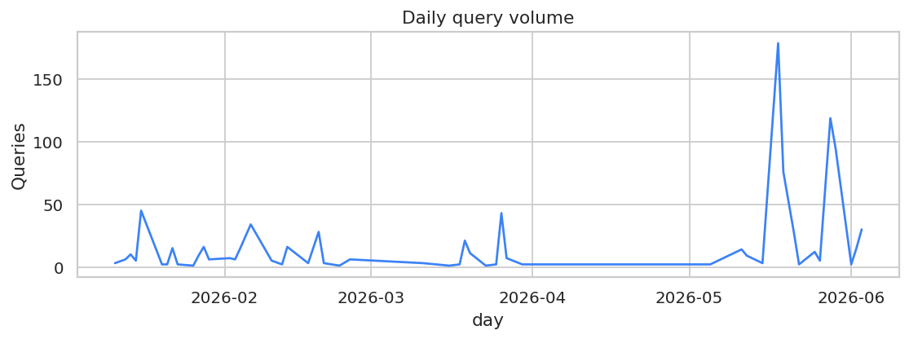
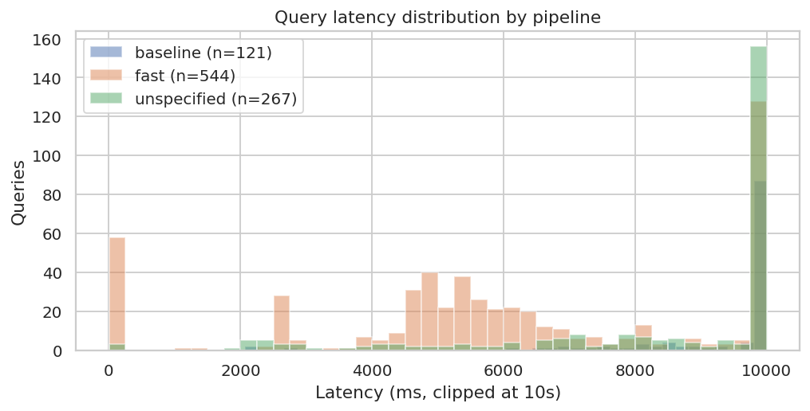
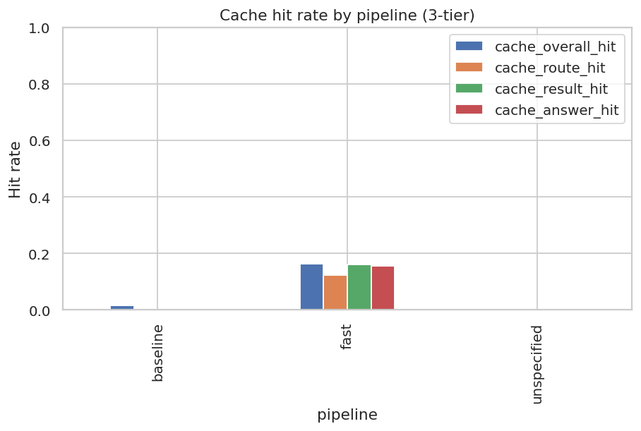
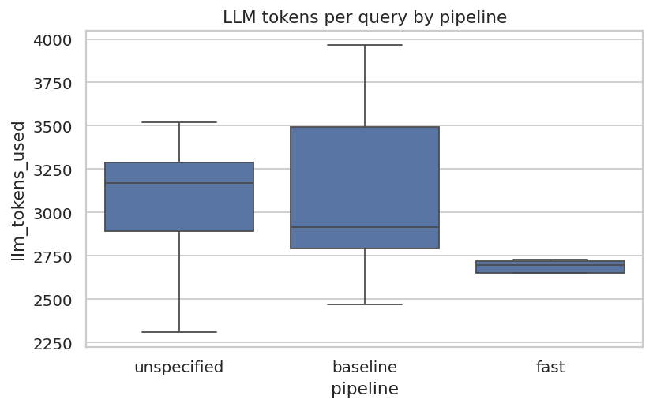
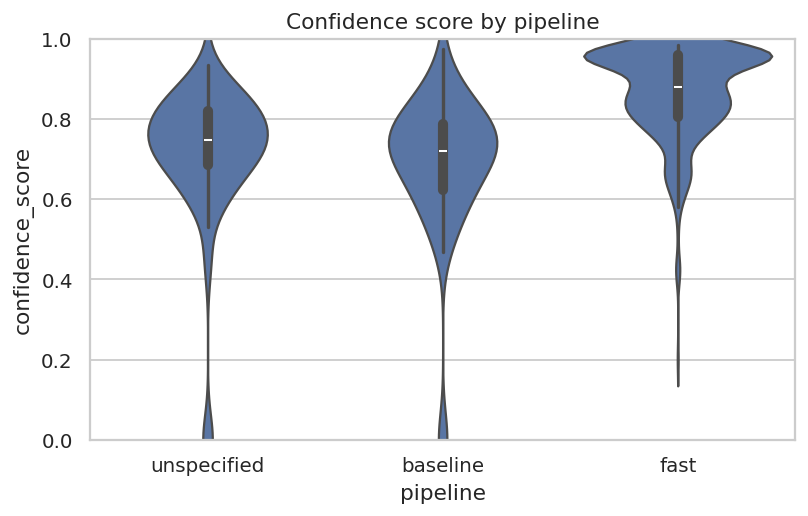
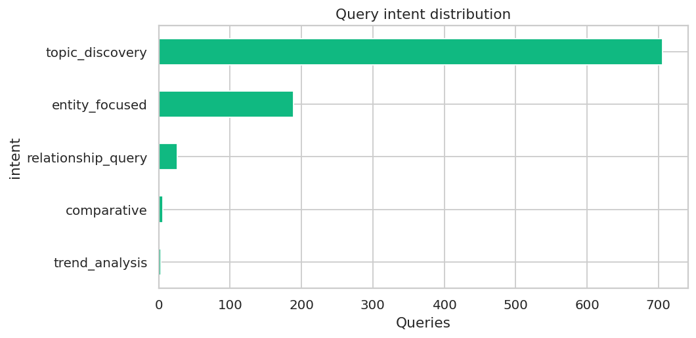
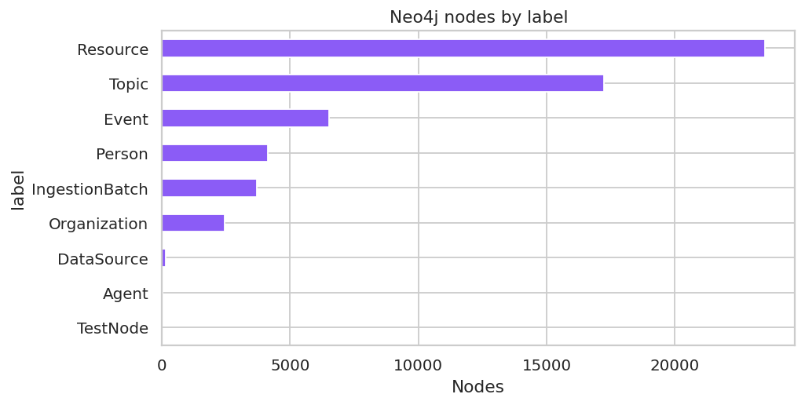

# Aurora Production Evaluation Report

**Window:** 2026-01-11 19:27:26.649554 → 2026-06-03 12:03:51.522032  
**Generated:** 2026-06-03  
**Query volume:** 932  
**Source:** `oracle_query_history` Postgres table + Neo4j corpus snapshot

---

## Executive summary

- **Pipeline split:** fast: 544, unspecified: 267, baseline: 121
- **p95 latency:** fast = 27658 ms, baseline = 22064 ms
- **Error rate:** 0.21%
- **User feedback:** none captured in the window
- **Total LLM tokens:** 554,971
- **Estimated LLM cost over window:** $3.47 (per-query avg $0.0037, see methodology)
- **KG corpus:** 57,669 nodes / 293,760 relationships; resources=23,511; agents=8
- **LLM-judge (baseline):** faithfulness 3.85, relevance 4.52, hallucination rate 21% (n=33)
- **LLM-judge (fast):** faithfulness 2.95, relevance 4.15, hallucination rate 20% (n=20)
- **LLM-judge (unspecified):** faithfulness 4.10, relevance 4.52, hallucination rate 6% (n=31)

**Verdict.** _Fill in 2–3 sentences based on the numbers above. Suggested framing: did the fast/KG pipeline meaningfully reduce latency or token cost vs. baseline at comparable correctness?_

**Limitations.** No domain-expert ground-truth corpus exists; correctness numbers are LLM-judge scored (claude-opus-4-7 by default) and should be read as relative, not absolute. All numbers are a single snapshot over the window above; this is not a longitudinal trend report.

---

## 1. Operational health

### Latency

| pipeline | n | mean (ms) | p50 | p95 | p99 |
|---|---|---|---|---|---|
| baseline | 121 | 13873 | 12199 | 22064 | 48544 |
| fast | 544 | 9451 | 5720 | 27658 | 75822 |
| unspecified | 267 | 13266 | 12001 | 26792 | 33714 |

### Errors

Overall error rate: **0.21%**

Top error messages:

| count | error |
|---|---|
| 2 | `4 validation errors for QueryResponse
documents.0.relevance_score
  Input should be less than or equal to 1 [type=less_than_equal, input_value=1.4, input_type=float]
    For further information visit ` |

### Cache hit rate (3-tier)

| pipeline | overall | route | result | answer |
|---|---|---|---|---|
| baseline | 1.7% | 0.0% | 0.0% | 0.0% |
| fast | 16.4% | 12.3% | 16.2% | 15.6% |
| unspecified | —% | —% | —% | —% |

## 2. KG (fast) vs RAG (baseline)

### Tokens per query

| pipeline | n | mean | p50 | p95 |
|---|---|---|---|---|
| baseline | 22 | 3105 | 2916 | 3787 |
| fast | 17 | 2603 | 2698 | 2844 |
| unspecified | 150 | 2949 | 3170 | 3445 |

### Confidence

| pipeline | n | mean | p50 | p95 |
|---|---|---|---|---|
| baseline | 121 | 0.69 | 0.72 | 0.89 |
| fast | 485 | 0.87 | 0.88 | 0.98 |
| unspecified | 188 | 0.71 | 0.75 | 0.88 |

## 3. LLM efficiency

- Total LLM tokens over window: **554,971**
- Average tokens per query: **2936**
- Estimated cost: **$3.47** total, **$0.0037** per query

Cost estimate uses rates: input $0.0025, output $0.0100 per 1K tokens (placeholder — confirm against Azure OpenAI pricing for the deployed model).

> Per-prompt-type breakdown requires parsing structured Loki logs and is omitted from this one-shot script. To add it, follow the methodology section: filter Loki for `llm.prompt_type` and aggregate.

## 4. Knowledge graph utilization

### Intent distribution

| intent | queries |
|---|---|
| topic_discovery | 706 |
| entity_focused | 189 |
| relationship_query | 26 |
| comparative | 6 |
| trend_analysis | 3 |

### Citation density

| pipeline | count | mean citations | median citations |
|---|---|---|---|
| baseline | 121 | 2.51 | 2.00 |
| fast | 544 | 6.21 | 6.00 |
| unspecified | 267 | 3.85 | 5.00 |

### Neo4j corpus snapshot

Captured at: `2026-06-03T13:07:38.086729+00:00`

| metric | value |
|---|---|
| total_nodes | 57,669 |
| total_relationships | 293,760 |
| orphan_nodes | 3,445 |
| resources | 23,511 |
| ingestion_batches | 3,713 |
| datasources | 152 |
| topics | 17,221 |
| people | 4,126 |
| organizations | 2,431 |
| events | 6,506 |
| agents | 8 |

## 5. User satisfaction

No user feedback captured during this window.

## 6. Correctness (LLM-as-judge)

Sample: stratified by (pipeline × intent), Azure OpenAI deployment = `gpt-4o-mini`.

| pipeline | n | faithfulness | relevance | citation usefulness | hallucination rate |
|---|---|---|---|---|---|
| baseline | 33 | 3.85 | 4.52 | 3.27 | 21% |
| fast | 20 | 2.95 | 4.15 | 2.90 | 20% |
| unspecified | 31 | 4.10 | 4.52 | 3.19 | 6% |

> Faithfulness, relevance, citation usefulness are 0–5 (higher is better).

---

## Appendix A — Methodology

- **Window:** 2026-01-11 19:27:26.649554 → 2026-06-03 12:03:51.522032
- **Total rows:** 932
- **Pipeline tagging:** read from `request_options->>'pipeline'`; rows without this tag are bucketed as `unspecified`.
- **Cost rates (placeholder):** input $0.0025/1K, output $0.01/1K tokens. Verify against the current Azure OpenAI pricing for the deployed model before publishing.
- **LLM-as-judge:** Azure OpenAI deployment `gpt-4o-mini`, sample size 100, stratified by (pipeline × intent). Rubric: 0–5 on faithfulness, relevance, citation usefulness; boolean hallucination flag. Full prompt embedded in `eval_aurora.py`.
- **Judge biases:** (1) LLMs tend to over-score verbose answers; (2) judge and answer-generator share the same model family (gpt-4o), so self-judge bias may inflate scores. Treat absolute numbers as relative; the more useful signal is the *delta between pipelines*, which any shared bias cancels out.
- **No ground truth:** there is no domain-expert-authored expected-answer corpus. Correctness numbers reflect citation grounding, not document correctness.
- **Reproducibility:** re-run `python eval_aurora.py [...]` to regenerate. Charts in `eval_output/charts/`.

## Appendix B — Glossary

- **fast pipeline** — KG-first; Cypher template + Neo4j lookup before fallback.
- **baseline pipeline** — vector + keyword retrieval + LLM synthesis.
- **intent** — high-level question classification (FACTUAL, ANALYTICAL, COMPARATIVE, TEMPORAL, ENTITY).
- **confidence score** — model-estimated 0.0–1.0.
- **cache tiers** — plan / result / answer caches in Redis (each ~1h TTL).

## Appendix C — Judged answer examples (PII-scrubbed)

### Worst-scoring (faithfulness)

| query_id | pipeline | intent | faith | rationale | question (truncated) |
|---|---|---|---|---|---|
| `e2df54e0-974` | unspecified | topic_discovery | 0 | The answer does not provide any information or citations related to the deployment of 802.11bc. | What is needed for an operator to deploy 802.11bc |
| `63fc2eae-150` | unspecified | relationship_query | 0 | The answer does not provide any information relevant to the question, thus cannot be considered faithful to the query. | @youtube who presented at cisco |
| `3f6971a9-6b2` | fast | entity_focused | 1 | The answer discusses QUIC for Wi-Fi but does not specifically address 802.11be developments. | what is the latest update on 802.11be |
| `4eacf111-887` | unspecified | entity_focused | 1 | The answer contains claims about Sam Altman's discussion, but the date of the summit in 2026 is not supported by available data as it is in the future. | What did Sam Altman talk about at Cisco AI Summit |
| `1dd8b1cc-4cb` | baseline | topic_discovery | 1 | The dates mentioned in the answer are in the future, making the claims unsupported. | What is the latest press release? |

### Best-scoring (faithfulness)

| query_id | pipeline | intent | faith | rationale | question (truncated) |
|---|---|---|---|---|---|
| `af828fcd-502` | baseline | entity_focused | 5 | The answer accurately states that inquiries about Passpoint should be directed to the Wi-Fi Alliance, supported by the provided citations. | Who do I talk to about passpoint? |
| `c9b47a8b-7d5` | unspecified | entity_focused | 5 | The answer accurately reflects the lack of specific information from the citations provided. | What happened this week? |
| `ca9930ac-f3f` | unspecified | relationship_query | 5 | The answer accurately reflects the information found in the citations regarding attendance at Wi-Fi Alliance working groups. | who from extreme networks attends wi-fi alliance working groups |
| `629d66a9-587` | baseline | topic_discovery | 5 | All claims made about Multi-Link Operation in Wi-Fi 7 are supported by the citations provided. | How does Multi-Link Operation work in Wi-Fi 7? |
| `7dc49e0c-ea5` | baseline | topic_discovery | 5 | All claims about TWT and its discussion in the context of Wi-Fi 6 and Wi-Fi 7 are supported by the provided citations. | What is discussed in the knowledge base about target wake time? |
