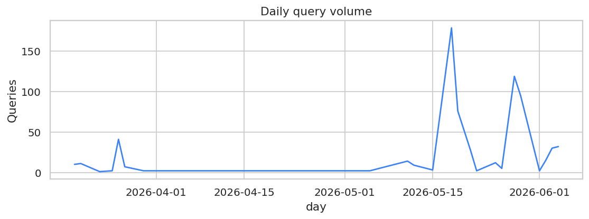
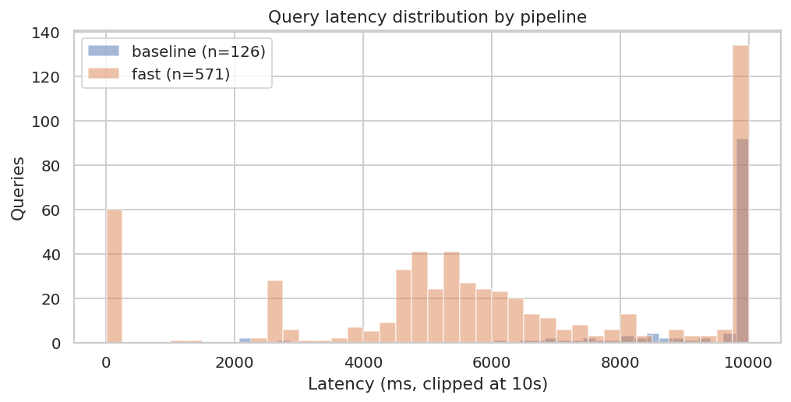
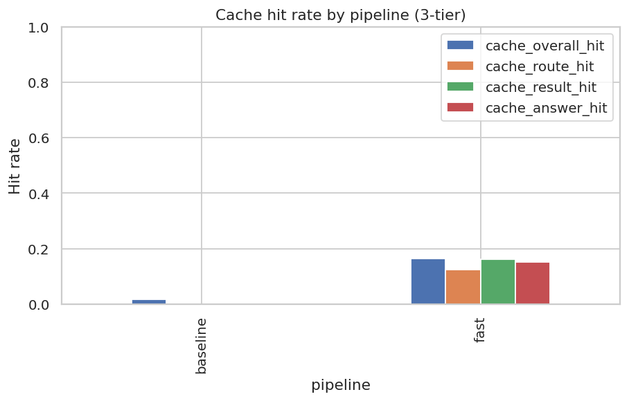
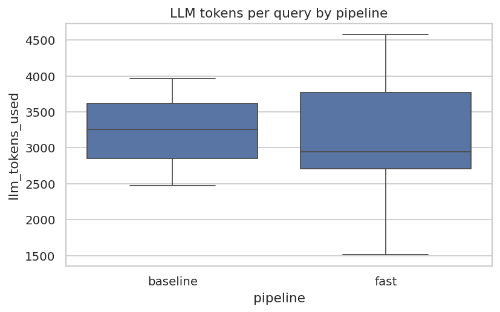
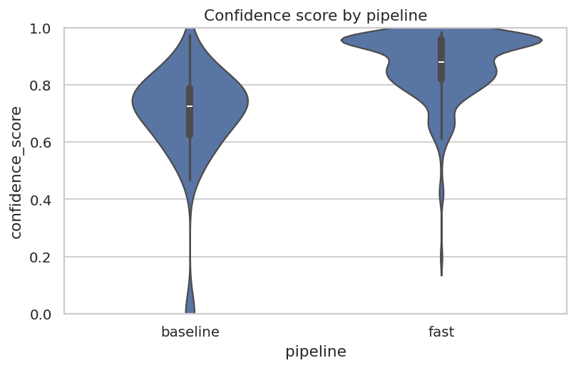
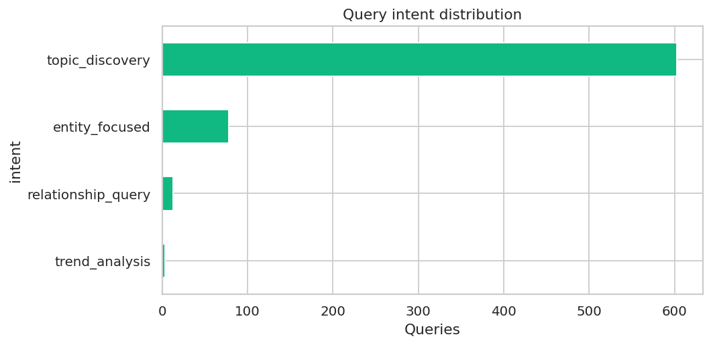
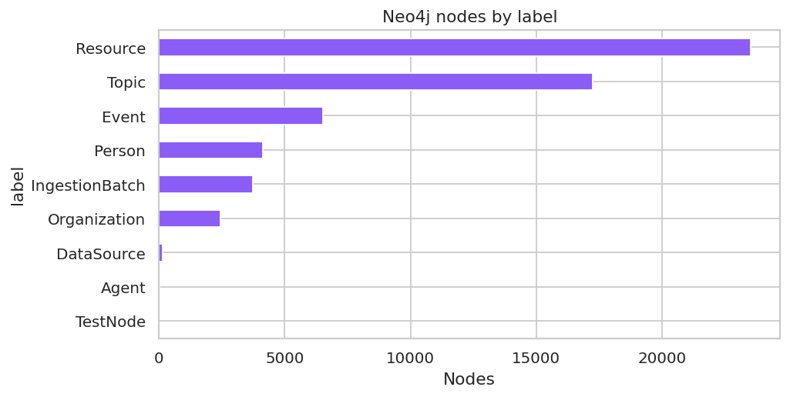

# Aurora Production Evaluation Report

**Window:** 2026-03-19 21:49:16.194968 → 2026-06-04 18:17:23.326116  
**Generated:** 2026-06-04  
**Query volume:** 697  
**Source:** `oracle_query_history` Postgres table + Neo4j corpus snapshot

---

## Executive summary

- **Pipeline split:** fast: 571, baseline: 126
- **p95 latency:** fast = 27152 ms, baseline = 28272 ms
- **Error rate:** 0.00%
- **User feedback:** none captured in the window
- **Total LLM tokens:** 216,367
- **Estimated LLM cost over window:** $1.35 (per-query avg $0.0019, see methodology)
- **KG corpus:** 57,714 nodes / 294,196 relationships; resources=23,515; agents=8

**Verdict.** _Fill in 2–3 sentences based on the numbers above. Suggested framing: did the fast/KG pipeline meaningfully reduce latency or token cost vs. baseline at comparable correctness?_

**Limitations.** No domain-expert ground-truth corpus exists; correctness numbers are LLM-judge scored (claude-opus-4-7 by default) and should be read as relative, not absolute. All numbers are a single snapshot over the window above; this is not a longitudinal trend report.

---

## 1. Operational health

### Latency

| pipeline | n | mean (ms) | p50 | p95 | p99 |
|---|---|---|---|---|---|
| baseline | 126 | 14425 | 12295 | 28272 | 48170 |
| fast | 571 | 9359 | 5716 | 27152 | 75723 |

### Errors

Overall error rate: **0.00%**

### Cache hit rate (3-tier)

| pipeline | overall | route | result | answer |
|---|---|---|---|---|
| baseline | 1.6% | 0.0% | 0.0% | 0.0% |
| fast | 16.5% | 12.4% | 16.1% | 15.2% |

## 2. KG (fast) vs RAG (baseline)

### Tokens per query

| pipeline | n | mean | p50 | p95 |
|---|---|---|---|---|
| baseline | 27 | 3204 | 3258 | 3878 |
| fast | 41 | 3167 | 2945 | 4218 |

### Confidence

| pipeline | n | mean | p50 | p95 |
|---|---|---|---|---|
| baseline | 126 | 0.69 | 0.72 | 0.89 |
| fast | 512 | 0.87 | 0.88 | 0.98 |

## 3. LLM efficiency

- Total LLM tokens over window: **216,367**
- Average tokens per query: **3182**
- Estimated cost: **$1.35** total, **$0.0019** per query

Cost estimate uses rates: input $0.0025, output $0.0100 per 1K tokens (placeholder — confirm against Azure OpenAI pricing for the deployed model).

> Per-prompt-type breakdown requires parsing structured Loki logs and is omitted from this one-shot script. To add it, follow the methodology section: filter Loki for `llm.prompt_type` and aggregate.

## 4. Knowledge graph utilization

### Intent distribution

| intent | queries |
|---|---|
| topic_discovery | 603 |
| entity_focused | 78 |
| relationship_query | 13 |
| trend_analysis | 3 |

### Citation density

| pipeline | count | mean citations | median citations |
|---|---|---|---|
| baseline | 126 | 2.54 | 2.00 |
| fast | 571 | 6.35 | 6.00 |

### Neo4j corpus snapshot

Captured at: `2026-06-04T21:06:18.070193+00:00`

| metric | value |
|---|---|
| total_nodes | 57,714 |
| total_relationships | 294,196 |
| orphan_nodes | 3,448 |
| resources | 23,515 |
| ingestion_batches | 3,739 |
| datasources | 152 |
| topics | 17,228 |
| people | 4,127 |
| organizations | 2,436 |
| events | 6,508 |
| agents | 8 |

## 5. User satisfaction

No user feedback captured during this window.

## 6. Correctness (LLM-as-judge)

LLM-as-judge was not run (use `--judge` to enable).

---

## Appendix A — Methodology

- **Window:** 2026-03-19 21:49:16.194968 → 2026-06-04 18:17:23.326116
- **Total rows:** 697
- **Pipeline tagging:** read from `request_options->>'pipeline'`. Legacy rows with no tag (pre-AB-test-removal) are excluded by default; pass `--include-legacy` to keep them.
- **Cost rates (placeholder):** input $0.0025/1K, output $0.01/1K tokens. Verify against the current Azure OpenAI pricing for the deployed model before publishing.
- **No ground truth:** there is no domain-expert-authored expected-answer corpus. Correctness numbers reflect citation grounding, not document correctness.
- **Reproducibility:** re-run `python eval_aurora.py [...]` to regenerate. Charts in `eval_output/charts/`.

## Appendix B — Glossary

- **fast pipeline** — KG-first; Cypher template + Neo4j lookup before fallback.
- **baseline pipeline** — vector + keyword retrieval + LLM synthesis.
- **intent** — high-level question classification (FACTUAL, ANALYTICAL, COMPARATIVE, TEMPORAL, ENTITY).
- **confidence score** — model-estimated 0.0–1.0.
- **cache tiers** — plan / result / answer caches in Redis (each ~1h TTL).
